# Arkive

**A Windows mod workbench for the Western/global Steam version of Lost Ark.**

Arkive finds game assets, exports editable working files, validates changes, rebuilds protected Unreal Engine 3 packages, and applies or restores mods with hash-verified backups. Mods are shared as portable `.arkive` files. The project includes a WPF desktop application, a command-line interface and a reusable core library.

Arkive is an **AGPL-3.0-only public preview**; the current version is on the [Releases](https://github.com/AN-SOTP/Arkive/releases/latest) page. This repository contains current source, tests, build infrastructure, dependency notices, GUI screenshots and application artwork/icon. No game packages, exported game assets, databases, mods, personal settings, credentials or historical development checkouts are distributed.

**Using Arkive always carries inherent risk. Creating, sharing or using mods may result in account suspension or a permanent ban.** There is no guarantee against crashes, client repairs, incompatibility, data loss or account sanctions. Use a client you are authorized to access and keep independent backups.

Mods contain or are derived from Lost Ark game data owned by its rights holders (Smilegate and Amazon Games), which Arkive does not license to anyone. Selling access to that data is commercial use of someone else's property, and anyone who does so carries that risk alone. Paywalled mods are not welcome in this project's issues, discussions or releases, and I request that no modifications made via Arkive are paywalled in any way, and are made publically
available.

Arkive operates on files **while the game, launcher and anti-cheat are closed**. It does not inject code, attach to the game process, disable anti-cheat or provide runtime hot-swapping. Closing those processes and passing Arkive's validation do not eliminate the risks above.

## Screenshots

The actual desktop GUI. The library and mod screenshots use fictional demonstration data; the Asset Viewer, Zone Viewer and Recolour screenshots show game models and maps read from a locally installed client. None of them are installable mods, and the repository contains no game files or personal library data.

### Asset Library

Search technical filenames and in-game names, then inspect an asset or its relationships.

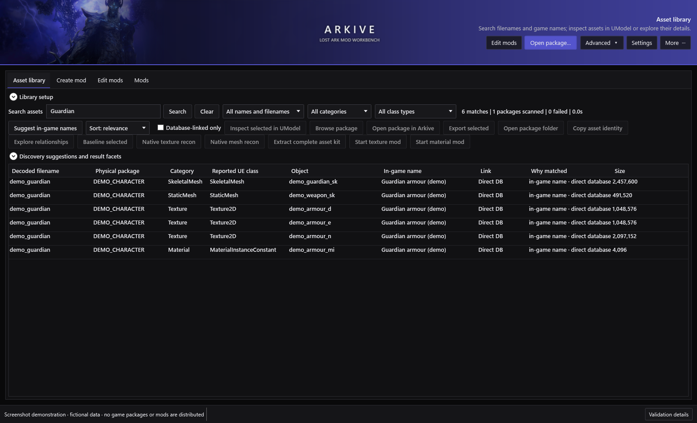

### Edit Mods

Keep a named draft, edit its working assets and add individual assets or a mesh's complete dependency kit.

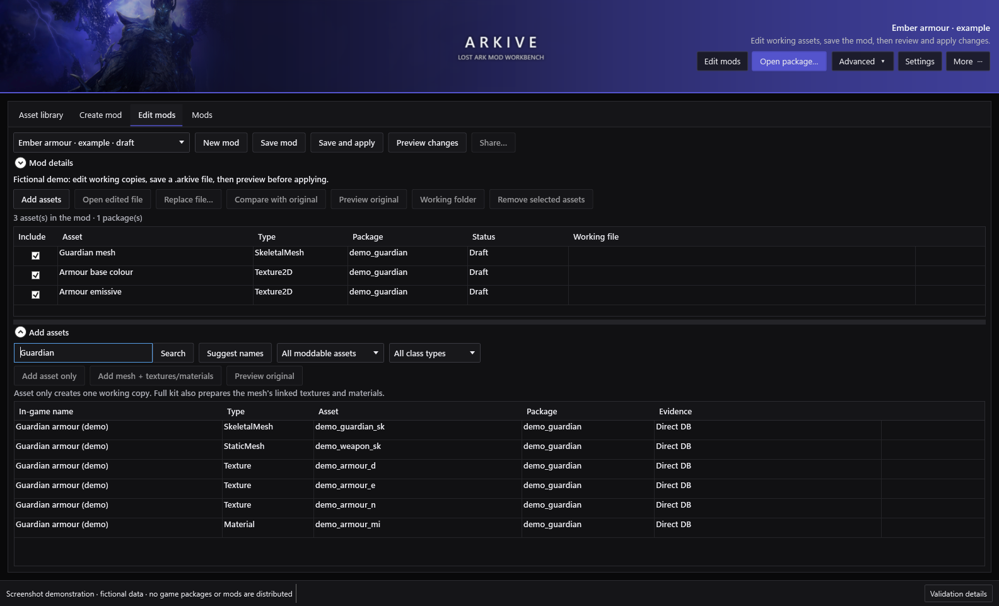

### Mod Library

Enable mods, set priorities and review the effective asset selection before applying changes.

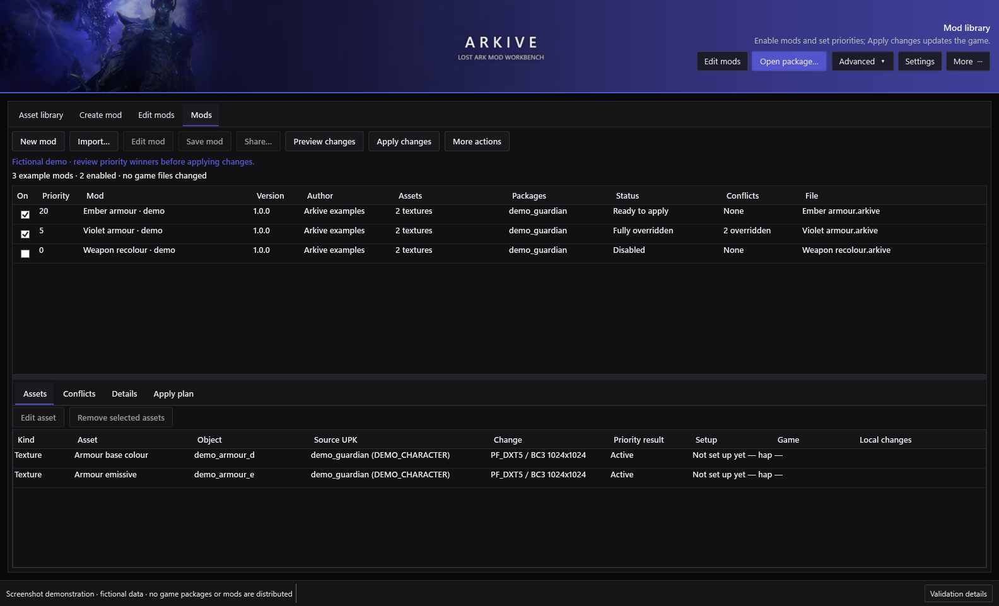

### Asset Viewer

Every LOD from Arkive's own decoder, coloured by the game's own compiled shaders, including glow and effect materials.

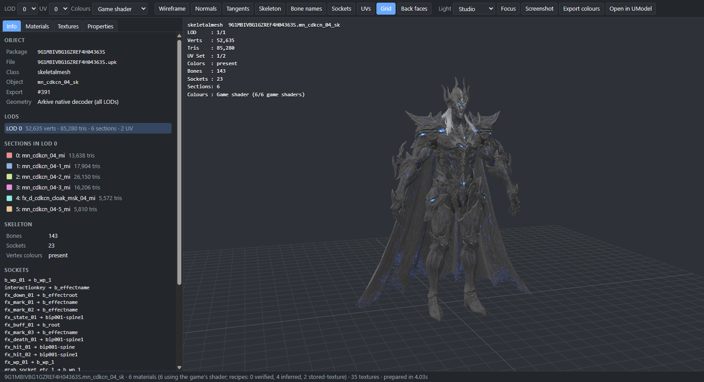

**Preview with edits** shows a mod's working files on top of the original asset and refreshes when they are saved (below shows a recoloured wing texture for Kazeros and changed hair colour for Serca).

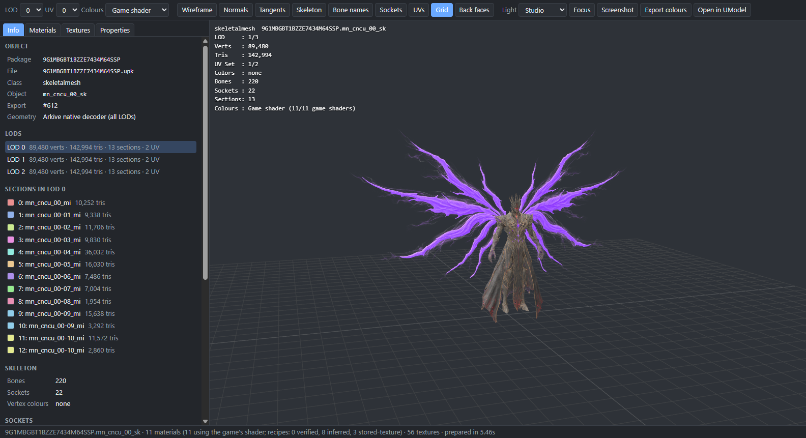

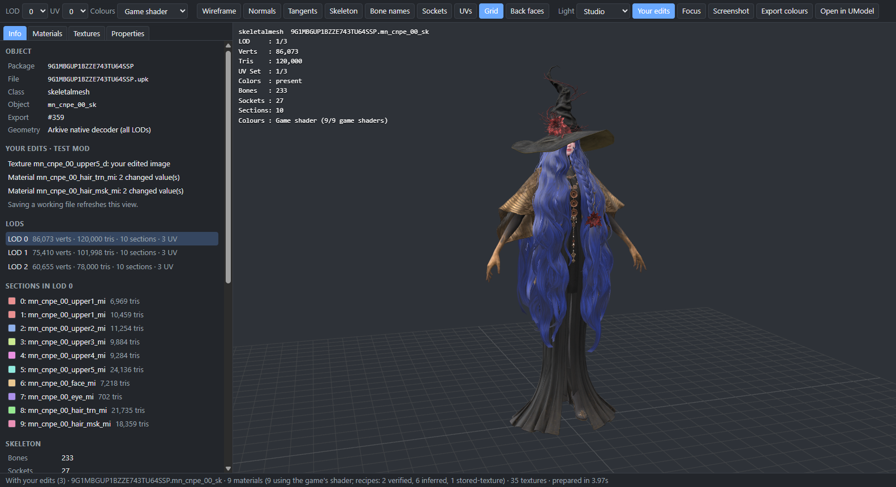

### Zone Viewer

Search a zone's name to open its map. Every part is grouped (terrain, sky, fog, lighting and colour grading, effects, characters, meshes, materials, textures) and marked as this map's own or shared with other maps, so a recolour changes only what you mean it to.

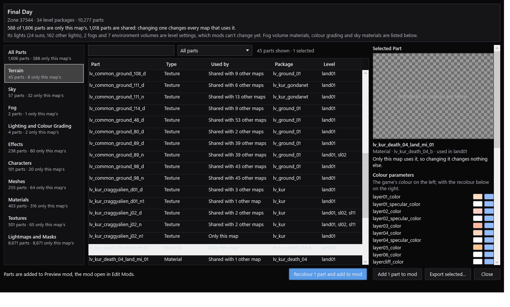

### Recolour

Recolour every selected picture, material and effect of a mod at once with one colour choice and a live before-and-after preview. Two-tone repaints in a main colour and puts a highlight colour on the lightest details and glows (here: Archdemon Kazeros in white with gold).

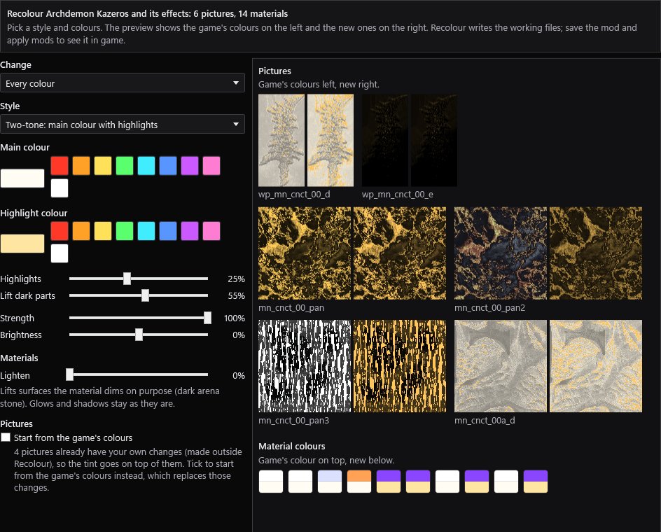

### Skill preview

Player classes, bosses and other NPCs play their skills from the game's own skill data: the animation, the weapon in hand, and every effect at its time and socket, drawn with the game's own effect shaders.

| | |
|---|---|
| 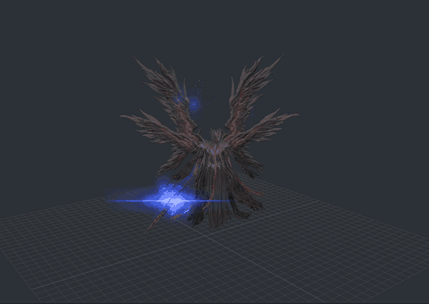 | 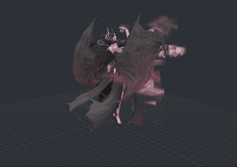 |
| **Kazeros** | **Echidna** |
| 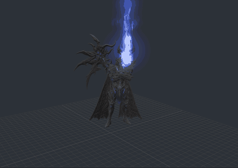 | 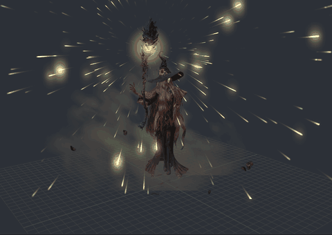 |
| **Thaemine** | **Serca** |

### Live in game example

Mods made with Arkive, running in Lost Ark.

**Kazeros 2-3 Cutscene**

https://github.com/user-attachments/assets/1f6c9379-cdef-4ee6-ab5f-9dbd0af5e39a

**Character creator**

https://github.com/user-attachments/assets/d1f532b4-41b6-44d6-9351-42392d6c7d74

**Echidna Raid Cutscenes**

https://github.com/user-attachments/assets/81b639c8-ce7a-41b1-869f-009deb6645c7

## Contents

- [Install and first run](#install-and-first-run)
- [GUI workflow](#gui-workflow)
- [Game names and metadata](#game-names-and-metadata)
- [CLI workflow](#cli-workflow)
- [How it works](#how-it-works)
- [Game updates and recovery](#game-updates-and-recovery)
- [Reporting a problem](#reporting-a-problem)
- [Application updates](#application-updates)
- [Build and release](#build-and-release)
- [Limitations and known issues](#limitations-and-known-issues)
- [Privacy, security and licensing](#privacy-security-and-licensing)

## Install and first run

### Requirements

- Windows 11 is recommended, 64-bit x64-compatible. The installer allows Windows 10 1809+, but .NET/OS support depends on edition and lifecycle; see [Microsoft's supported OS list](https://github.com/dotnet/core/blob/main/release-notes/10.0/supported-os.md). Older Windows and Windows on ARM are not verified Arkive targets.
- A Western/global Steam Lost Ark installation; write access to its Packages folder when applying/restoring mods.
- Space for exports, decoded packages, staged builds and original backups. A large kit can use several times its source package size.

### Installer

1. Download the latest `Arkive-Setup-X.Y.Z-win-x64.exe` from [Releases](https://github.com/AN-SOTP/Arkive/releases/latest). Optionally compare `Get-FileHash -Algorithm SHA256 PATH` with the release's `.sha256` file.
2. Close running Arkive instances, run the installer and choose destination/shortcut options.
3. In **Asset library → Library setup**, select your client's `EFGame\ReleasePC\Packages` directory and choose **Build / update index**. Source packages are read, never renamed.
4. Choose **Build game DB**, select `EFGame\data2.lpk`, and wait for the mapping to load. Technical and in-game-name searches are now available.

The per-user installer normally needs no administrator access. Its default destination is `%LOCALAPPDATA%\Programs\Arkive`. It includes the .NET runtime, native Crunch decoder bridge, the exact tested Lost Ark UModel build, SDL libraries, pinned Crunch encoder, and the database builder's managed cryptography/SQLite libraries and native SQLite runtime. Database building, editing and deployment need no separate .NET, Visual Studio, Python or QuickBMS install.

Dependencies are installed privately alongside Arkive, not as machine-wide prerequisites. The installer does not need to detect or download existing global runtimes: the tested versions are always provided, including on an offline machine. Upgrades replace the application's own dependency files and preserve its separate data folder. Building from source still requires the developer tools listed under **Build and release**.

The preview installer is **not Authenticode-signed**. Windows may show an unknown-publisher/SmartScreen warning. Verify trusted source and hashes; hashes are not publisher signatures.

### Data and existing libraries

Installed Arkive keeps `mods`, `staging`, `cache`, `backups`, `logs` and downloaded `updates` under `%LOCALAPPDATA%\Arkive`. Application upgrades/uninstall preserve this folder. Uninstall does not restore the game: restore active mods first.

Each session writes a log to `logs`. It starts with the Arkive version, Windows and .NET versions, and lists every mod with its version, whether it is enabled and in game, and the packages it changes; that list is written again whenever it changes. Attach the log when reporting a problem.

Source/portable builds retain project-root behavior. Set `ARKIVE_DATA_ROOT` to use an existing library or another drive. This does not automatically move another checkout's data:

```powershell
$env:ARKIVE_DATA_ROOT = 'E:\ArkiveData'
& "$env:LOCALAPPDATA\Programs\Arkive\Arkive.App.exe"
```

Use a trusted local folder, not the game's Packages directory. Avoid simultaneous instances against one data root. Back up the whole data folder for migration: shared `.arkive` files are portable, but drafts, source evidence and restore receipts are separate.

## GUI workflow

The primary tabs separate discovery (**Asset Library**), creation (**Create Mod**), editing (**Edit Mods**, **Simple Upscale**), sounds (**Sounds**), the login screen (**Login Screen**) and deployment (**Mods**). **Advanced** retains native diagnostics and specialist/legacy workflows.

### Asset Library

Search **All names and filenames** by physical/decoded package filename, object, class or loaded in-game name. The full index includes assets even when their class is not moddable. Inspect a selected object in UModel, browse its package, open it in Arkive, export it, copy its identity or explore evidence-labelled relationships. UModel and Arkive may support different display types. Direct database links, verified dependencies and candidate mappings are deliberately distinguished.

**Preview** (or double-clicking a mesh) opens the Arkive Asset Viewer. It shows every LOD of skeletal and static meshes decoded by Arkive's own parser, with UModel's materials, textures and object properties alongside: LOD and UV-set switching, wireframe, normals, tangents, skeleton, bone names, sockets, UV layout, material IDs, vertex colours, section isolation, texture channels, screenshots and PgUp/PgDn browsing. Objects UModel cannot read still show their geometry. By default each material runs **the game's own compiled shader**: the exact permutation the material uses, translated from the client's shader cache, so packed textures (for example two-tone hair masks) appear in their game colours, glow shows, and effect materials are drawn as the light they emit. Per-family colour recipes and the stored textures, as UModel shows them, remain available for comparison. **Export colours** saves each material's colours, as shown, as textures laid out on UV set 0. The first preview indexes the game's shaders once (about 30 seconds, about 8 MB in the data folder); prepared scenes are cached up to 1 GB. The viewer follows the files it reads: when the object's package or any package its materials and textures come from changes (for example when a mod is applied or restored), the open view refreshes and keeps the camera. In mod authoring, **Preview with edits** shows a mesh from its clean package with the mod's edited GLB, texture images and material values on top, and refreshes whenever one of those working files is saved; **Your edits** (E) switches back to the original. **Animation** plays the character's own game animations (idles, character select, walking and running, emotes, dances and poses; NPCs and monsters their own set) with pause and speed, so clipping shows in motion; the first time for a class Arkive has UModel export its animations once (about 10 seconds, about 40 MB cached). The **Lighting** panel and the **Game environment** light mode light the model with the game's own environment maps (the reflections and sky light it uses for characters), optionally shown as a blurred background, rotated or brightened, plus a sun that can be aimed, dimmed and recoloured (Shift-drag in the view moves it); Daylight, Overcast, Evening and Interior presets set them all, and Studio goes back. **Sky** puts one of the game's own skies (about 75, from its dynamic sky package, exported once and cached, about 125 MB) behind the model, turning with the environment; it can also light the model, and **Sky horizon** moves where its horizon sits, since the viewer wraps it on a dome rather than the game's own sky mesh. The viewer needs the Microsoft Edge WebView2 Runtime, which ships with Windows 10 and 11.

**Skills** (a tab of the Asset Viewer) plays skills on a player body or on a boss or NPC model. For a player body, choose a class and one of its skills; for a monster or NPC model, the tab lists the skills of every NPC that uses that model (open Kazeros's `MN_CNCS_00_SK`, Thaemine's `MN_CDKCN_00_SK` or Serca's `MN_CNPE_00_SK`). Skills come from the game's own action files: each stage's animation and each effect it starts, at its time, socket, offset and size, with the class weapon (or the boss's weapon and armour) attached. A skill with several versions (tripods, an overcharge) lists each, and skills with alternative effect sets (FX-01, Exmove...) can switch between them. **Play skill** loads the animations and effects with a progress bar (the first time for a class or boss takes longer), then plays, loops or replays without loading again, at 0.1× to 1× speed; choosing another skill switches straight to it. Effects are simulated from each effect's own settings (spawn rates and bursts, lifetimes, sizes, colours and velocities over life, orbits, flipbooks, mesh particles and ground decals) and each material runs its own game shader, soft-faded where it meets the ground and blended with bloom. NPC skills have no names in the game's text, so they are listed by the developers' (Korean) names and their first animation.

**Zone names** work as searches too: type a zone such as Land of Death and Order or Final Day and a map card appears above the results; once the map sharing index is built (about 25 seconds the first time, then cached), ordinary results also name the maps an asset is used in. **Open in Zone Viewer** lists the map's parts by kind (terrain layers, sky, fog volumes, lighting and colour grading, effects, characters, meshes, materials, textures, lightmaps), each with a preview and marked **Only this map** or **Shared with N other maps**. Its **3D Map (Early Preview)** tab draws the whole map. It is a very early, extremely rough preview: many areas will not look as they do in game, detail can drop out up close, and colours and lighting are approximate. It uses the map's own baked lighting, lighting cubemap, fog and colour grading; **Go to** jumps between arenas, **Game camera** frames them from the game's angle, and sky and clouds, glows, water and effects, and cutscene sets have their own switches. Clicking a piece selects it. A map takes about 15 to 45 seconds the first time; the last three are cached at roughly 40 to 110 MB each. Choose colours under **Recolour selected parts** to preview them on the parts and the map, then **Recolour and add to mod** adds the parts to the mod open in Edit Mods as normal working copies and recolours them; **Add selected to mod** adds them unchanged and **Export selected…** saves them as files. Lights and height fog colours are level settings mods cannot change yet, so they are counted but not listed.

The local index is resumable. Worker count and optional fast scratch storage help indexing. The setup panel collapses after configuration; refresh the index when the client changes.

### Create

1. In **Create Mod**, enter a name and optional version/author/description. **Create Mod** saves a draft and opens **Edit Mods**; no game files change.
2. Expand **Add assets**, search by game/object name and select results. **Add asset only** prepares one editable GLB, PNG/DDS or material project. **Add mesh + textures/materials** prepares a skeletal mesh and its exact resolved dependencies as a structured kit. References start excluded; tick **Include** only for assets your mod should replace. Some packages hold two textures or materials with the same name in different groups (for example `tex.pc_dl_av_214_head_orm` and `pc_dl_av_214_head_orm`); the kit adds the one the mesh's material uses, Add assets adds the row you select, and the working list shows the group so the two can be told apart. A link the kit cannot add stays in the exported kit, is named in the status line and is explained in the session log. When a mod is installed over the mesh's package, the mesh is read from its clean backup while its linked textures and materials are still found in the game folder.
3. Use **Preview original** to inspect sources: meshes open in the Arkive Asset Viewer, where PgUp/PgDn step through these search results, and textures and materials open in UModel. **Open in UModel** opens any selected asset in UModel instead. Extraction shows stage, elapsed time and dependency counts, with cancellation at safe checkpoints. Original previews remain available during extraction; editing/building waits until completion.
4. Select a working asset and use **Open edited file**, **Working folder**, **Replace file**, **Compare with original** or **Edit material**. Edit the working file displayed in the table. Export meshes back as GLB while retaining the target contract. When a working mesh is saved again (for example from Blender), Edit mods checks it as soon as you come back to Arkive: a mesh that would be refused shows **Fails mesh check**, and selecting it lists each problem with what to do, so it can be fixed before **Save mod**.
5. **Save mod** validates included edits and writes a `.arkive` file. New mods start disabled; saving is not installation.
6. **Preview changes** shows the hypothetical enabled result without changing files. **Save and apply** saves/enables, reviews the actual plan and applies after confirmation. You can also enable later in **Mods**.
7. **Share** saves and validates before copying the portable file to your chosen destination.

### Edit

Choose **Mods → Edit mod**, or use the **Edit Mods** selector. Missing working copies are prepared against a verified clean client, using verified backups if Arkive has an active package replacement. Existing working edits are retained. Edit, save, then preview/apply the new composition with the game closed.

**Recolour…** recolours every selected picture, material and effect at once (all of them when nothing is selected) with the same choices as the Texture Viewer: every colour, one colour range or the light areas; a new colour, strength and brightness; and the style. **Tint** keeps each colour's shading and takes the new hue. **Two-tone** repaints pictures in a main colour with their own shading and gives their lightest, raised details a highlight colour; materials' surface colours take the main colour and their glows the highlight, and effects and glow pictures (emissive and panning maps) take the highlight. A before-and-after preview shows the first pictures and each material colour. **Lighten** lifts surfaces a material dims on purpose (the stone of a dark arena), and **Also tint the effects' materials** adds and tints the materials of effects whose colour comes only from them (effect materials can be shared by other effects). Pictures start from the game's colours, so trying again replaces the last recolour; pictures you changed elsewhere (in an image editor, say) keep your changes and are tinted on top unless you tick **Start from the game's colours**. Everything Recolour touches stays an ordinary working copy: open, replace, compare or edit it further as before. The Texture Viewer's **Edit colours** has the same two-tone style for one picture or part.

In the Asset Viewer's **Skills** panel, **Recolour this model and its effects…** adds a model's colour pictures (not normal maps or masks) and materials, with its parts and weapons from its look file, and every effect of all its forms' skills and its look, to the mod open in Edit Mods (or a new mod named after it), then opens Recolour on them, starting from white with gold highlights. Effects from packages many skills share are left out so other bosses keep theirs.

Ctrl-click toggles rows, Shift-click selects a range and Ctrl+A selects every row in the focused table. **Remove selected** affects all selected assets; single-file edit/compare/preview needs one row. Clearing a draft preserves working files and the previous saved archive. An empty draft cannot become a valid shared mod.

Drag dividers to resize working/search tables and mod/detail panes. Collapse Add assets, metadata or library setup when unnecessary. Pane sizes, density, theme and random/fixed banner preferences persist.

### Simple Upscale

**Simple Upscale** reshapes player bodies and outfits, and a few NPCs, without Blender. Its search lists only player character bodies and outfit pieces (tops, bottoms, one-piece outfits, arms and shoulders) and the NPCs Brelshaza, Echidna, Nineveh, Serca and Beatrice; faces, hair, headwear, weapons, other NPCs and objects are left out. **Open in proportion editor** shows the selected piece and, with **Open the whole outfit** ticked, the outfit's other pieces, in the Arkive Asset Viewer with game colours and a **Proportions** panel. Its sliders, each with a number box, come in groups:

- **Arms and neck:** neck, shoulders, upper arms and forearms.
- **Breasts** (chest on male bodies): size, width, projection, height, lift, spacing and, on female bodies, sag.
- **Waist and belly:** waist, waist width, waist depth and belly.
- **Hips and buttocks:** hips, and buttocks size, width, projection, lift and sag.
- **Legs:** thighs, thigh width, thigh depth and calves.

The model changes as you move them. **Save as mod** creates a new mod with a working copy of each piece, reshaped with the same values, and saves it; enable it in **Mods** to apply it like any other mod.

- Each area is found from the bones that move it, so tight clothing and the body under it change together, and an outfit's pieces keep meeting at their seams. Arkive recognises eight base player bodies from their skeletons (female specialist, mage, martial artist, warrior and assassin/gunner; male specialist, gunner/martial artist and warrior); every class of a body shares its tuning. Each supported NPC has tuning of its own.
- **Loose clothing follows the body** and **Hair follows the body** (both on by default) move skirts, capes, coat tails, sashes, drapes and hair, which hang from bones of their own, with the body surface nearest to them, so the body does not grow through them. The fade-out of each area is measured across the body, not in depth, so every layer over a spot (skin, a top, a coat) moves together.
- Thickness, shape and placement change; height and limb length do not, because the game's skeleton and animations set them. Every LOD is reshaped; normals and tangents turn with the new shape so lighting, shadows and normal maps follow it (in the preview too); bones do not change, and saving runs the usual skeleton and animation stress checks.
- **Presets:** type a name in the editor's **Preset** box and choose **Save preset** to keep the sliders and follow options for that body; choosing a preset sets every slider. In the tab, select any number of outfits of one body, choose a preset and **Apply preset to selected outfits** to reshape them all (with their other pieces when **Open the whole outfit** is ticked) and save them as one new mod without opening the editor. **Apply preset to every outfit of its body** does the same for every player outfit of the preset's body (for example all Female Warrior outfits: about 290 outfits, 540 pieces). Arkive first says how many that is, roughly how long it takes (about 3 seconds per piece, so around half an hour for one body) and how much disk the working files and mod need (about 9 MB per piece). On a PC with four or more processor threads it then offers to work on several pieces at once (two to four, half the threads): about 2.5 times faster with four, but it keeps those threads busy and uses about twice the memory, so the PC may feel slower until it finishes. A piece that fails its mesh check with those settings is left out and named, and the rest are saved; **Stop** ends it after the current piece and keeps the pieces done so far as a draft in Edit mods.
- **Editing a saved upscale mod:** open it in **Edit Mods** and choose **Edit in proportion editor**. The outfit reopens from the clean game files with the mod's sliders (kept in the mod's tags; mods saved before 0.3.2 are read from their description), and **Save as mod** updates that same mod instead of creating a new one. Apply it again in Mods to put the new shape in the game. Mods with more than 20 pieces (body-wide ones) are changed by applying an edited preset to the body again.
- The editor and viewer can play the character's animations and use game lighting (see Asset library above), to check an outfit in motion and in game-like light before saving.
- A mod replaces the outfit (or NPC) for every character you see wearing it. Very large or combined values can still make pieces overlap.

### Particle effects and interface

**Particle effects** are a mod type: search the Asset Library for an effect (filter by particle effects), **Preview** it in its own window, or add it in **Edit Mods** and choose **Edit effect**. The window plays the effect live (play, pause, restart, speed, loop, grid and background) and shows each change as it is made: a tint colour and strength, and multipliers for brightness, opacity, size, lifetime, spawn rate and speed, with emitters that can be hidden one by one. **Save changes** keeps the settings in the mod's working copy; the mod writes the patched values into the effect's package like any other edit.

**Interface movies** (the game's Scaleform HUD and menu movies) are a mod type too, and interface names are searchable, so "health bar" finds the picture that draws it. **Preview** on a texture opens it in the Arkive Texture Viewer; in Edit Mods, **Edit colours** recolours a texture working copy whole or one named part of an interface atlas at a time.

### Sounds

**Sounds** plays the game's sound effects, voices and music and replaces single clips with your own audio. Search by a sound's name: the names are the developers' own (bgm for music, vox for voices, Korean boss names such as kazeroth for Kazeros; Kazeros, Thaemine, Akkan, Brelshaza and Vykas are translated for you). The list shows each sound's length, how many clips it has (the game picks between variations), whether it is music, a voice or an effect, and whether you replaced it. The first search reads the game's sound banks, which takes a few seconds.

**Listen and replace** (or a double-click) opens the sound's clips with play, pause, stop, a position bar and volume. **Replace with audio file** takes a .wav, .mp3, .ogg, .flac, .m4a or .wma file, converts it to the clip's channels and sample rate, and writes it into the game's audio files (close Lost Ark first). Music keeps its original length so it still loops and changes on cue: a longer file is cut with a short fade, a shorter one ends in silence. **Restore original** puts the game's audio back, and **Restore all sounds** does it for every clip you replaced. **Save as WAV** saves a clip as the game plays it now. A game update or a Steam file check puts the originals back; the clip then says so and can be replaced again.

### Login Screen

**Login Screen** brings back the screen of an earlier update behind the game's login and server select menus, with that screen's own music and ambience. The game keeps the earlier screens' videos in its Movies folder (Eclipse, Kazeros, Kurzan, Vern, Voldis, Elgacia, Papunika and more), and each tile shows a picture of its video. Pick one and **Use this screen**. The game always shows its current update's screen, so Arkive writes the chosen video over that screen's file (each video is scrambled with its own key, which Arkive works out from the video's header) and points that screen's music and ambience events at the chosen screen's in the game's sound banks. **Your game shows** names the screen the game shows on its own; change it only when an update brings a new one. Arkive keeps the game's video and records every sound id it changes, so **Back to the game's own** puts them back byte for byte. It shows the next time Lost Ark starts, and the game must be closed. A game update replaces the files; the tab then says so and you choose again. Faton's video is in a format Arkive cannot read yet.

### Import, priorities and deployment

Use **Mods → Import**, or open a `.arkive` file with Arkive. Import never installs automatically. Review, enable, set priority, preview the plan, then confirm **Apply changes**.

- Higher numeric priority wins for the **same native asset**.
- Edits to different assets within a UPK are composed into one package.
- Equal-priority competing edits block Apply. Change priority or use **Make this mod win**.
- Resolved ownership is not proof of animation/material compatibility; dependency and source checks still run.
- Enable/priority edits are desired state. Only confirmed Apply changes the game.
- When enabled mods change the same assets, a warning above the list names each pair and which mod wins, with buttons to make the other mod win or show the shared assets. **Hide** keeps it out of the way until the overlaps change; ties can't be hidden.
- **New pack…** (or right-click a mod → **Add to pack**) groups mods, such as a mod split into several parts, under one heading whose box turns them all on or off. Each mod keeps its own priority; right-click the heading to edit the pack, make it win its overlaps or remove it (its mods stay). Packs are kept in `arkive-mod-packs.json` beside the mod library, so earlier versions open the same library without them.

#### Restoring the original game files

There is no separate restore button for a mod: the **On** ticks say which mods should be in the game, and **Apply changes** makes the game match them.

- **Restore one or more mods:** untick **On** for those mods and choose **Apply changes**. The plan marks the affected packages **Restore**: a package no enabled mod changes any more is put back from its verified backup, and a package another enabled mod still changes is rebuilt without the unticked ones. The mods stay in the library, so ticking them and applying again reinstalls them.
- **Restore everything:** **More actions → Restore all game files** puts back every package Arkive installed and keeps your ticks, so a later **Apply changes** reinstalls the ticked mods. To turn everything off for good, untick every mod and apply instead.
- **Changes pending** and "0 fully in game" in the status line mean ticked mods are not in the game yet; nothing changes until you apply.
- Removing a mod from the library or deleting its `.arkive` file does not restore the game. Restore first.
- **Game file changed outside Arkive** in the Status column means a file your mods target is not the version they were made for, and this Arkive has no record of changing it: another Arkive data folder (for example an older install), another tool or a game patch changed it. Apply is held back so the changed bytes are never built on or backed up as the original. If an older Arkive installed mods, choose **More actions → Restore from another Arkive folder…** and pick that Arkive's data folder (the one holding its `backups` folder): each original is found and checked by its SHA-256, the file it replaces is kept under `backups
eplaced-outside-arkive`, and Lost Ark must be closed. Otherwise use Steam's Verify integrity of game files; after a game patch, use **Update for this game version**.

Assets, Conflicts, Details and Apply plan panes explain the effective result. **Advanced → Package projects** retains per-package rebuild, inspection, bulk install/restore, source evidence and cleanup. Prefer the named-mod workflow for normal use.

## Game names and metadata

No game database is distributed. Both the installed GUI and CLI build the in-game-name mapping directly from your client's `EFGame\data2.lpk`. In **Asset library → Library setup**, choose the language and **Build game DB**. Progress shows archive decoding and mapping stages; **Cancel DB build** stops the operation. The resulting mapping loads automatically and is remembered for the next launch.

```powershell
$cli = "$env:LOCALAPPDATA\Programs\Arkive\Arkive.Cli.exe"
& $cli database-build 'E:\Games\Lost Ark\EFGame\data2.lpk' --language English
# Optional explicit destination and JSON result; progress goes to stderr:
& $cli database-build 'E:\Games\Lost Ark\EFGame\data2.lpk' --out 'E:\ArkiveData\staging\lpk\arkive-asset-metadata.json' --language English --json
```

The default output is `staging\lpk\data2-fixed\arkive-asset-metadata.json` under Arkive's data root. **Load mapping** accepts an existing JSON. Rebuild after client updates when mappings change; then refresh verified asset links as needed. Database building does not itself scan every UPK or generate those dependency links.

The builder reads only the supported main-client tables, handles LPK Blowfish word order and filename-derived AES with per-0x400-byte CBC resets, and reads SQLite in read-only mode. Decrypted tables are temporary and removed on success, failure or cancellation; only the mapping is retained. A failed/cancelled build leaves the previous mapping untouched. Current Western/global schema and a language present in the client are required; unsupported protection/schema changes are refused.

Legacy Python/BMS scripts remain in source for format research, with upstream credits, but are not required by the installed workflow. All outputs stay local; do not redistribute game databases or generated game-data mappings.

## CLI workflow

The installer includes `Arkive.Cli.exe`. For source builds replace `& $cli` with `dotnet run --project src/Arkive.Cli -c Release --`. `--help` lists all native commands; `--version` prints the version. Most commands accept `--json`. Paths/object names below are examples, not real required asset identities.

```powershell
$cli = "$env:LOCALAPPDATA\Programs\Arkive\Arkive.Cli.exe"
$data = "$env:LOCALAPPDATA\Arkive"
$packages = 'E:\Games\Lost Ark\EFGame\ReleasePC\Packages'
& $cli --help
& $cli inspect "$packages\PACKAGE.upk" --json
& $cli catalog "$packages\PACKAGE.upk" --filter hero
& $cli index-build $packages --cache "$data\cache\library-index" --workers 4
& $cli index-search $packages --cache "$data\cache\library-index" --metadata "$data\staging\lpk\arkive-asset-metadata.json" --query 'Brelshaza' --scope ObjectAndInGameName --limit 50
```

Use the exact physical package/object identity from your own index. Do not rename client packages. Initialize the data root/game configuration in the GUI before library deployment commands.

### Shared mods

```powershell
& $cli arkive-inspect 'E:\Downloads\Example.arkive' --json
& $cli arkive-import 'E:\Downloads\Example.arkive' --root $data
& $cli arkive-list $data
& $cli arkive-set $data --mod 'Example' --enable --priority 5
& $cli arkive-conflicts $data
& $cli arkive-plan $data --json
# Review first; game/launcher/anti-cheat must be closed:
& $cli arkive-apply $data --confirm

# Restore packages no longer contributed by this mod:
& $cli arkive-set $data --mod 'Example' --disable
& $cli arkive-plan $data
& $cli arkive-apply $data --confirm
```

Use IDs from `arkive-list` when names collide. Import supports `--enable`, `--priority N` and explicit `--replace`; game installation still needs Apply. `arkive-update` concerns **game-client compatibility**, not application updates:

```powershell
& $cli client-update-check-all $data --json
& $cli arkive-update $data --mod 'Example' --json
& $cli arkive-plan $data
```

### Lower-level authoring

The CLI exposes native project stages rather than the GUI's interactive named draft. Each stage reports a manifest consumed by the next; use actual reported paths.

```powershell
# Texture: export, edit PNG/DDS externally, register a project:
& $cli texture-export-native "$packages\PACKAGE.upk" --object OBJECT --alias ALIAS --out "$data\staging\manual\texture"
& $cli texture-project-create 'PATH\arkive-native-texture.json' --edited 'PATH\edit.png' --workspace "$data\staging\texture-mods" --name 'Example texture' --alpha preserve-original

# Simple upscale: reshape an editable player or supported NPC mesh GLB by area (percent), optionally moving loose cloth and hair too:
& $cli body-proportions 'PATH\editable.glb' --set chest=20 --set hips=10 --loose-clothing --hair --out 'PATH\edit.glb'
# Viewer animations: convert a character's AnimSet into the viewer's cached clips:
& $cli model-viewer-animations "$packages\PACKAGE.upk" --animset pc_wr_f_00_ani --cache 'PATH\animations'
# Skeletal mesh: recon, editable export, external GLB edit, validation/registration:
& $cli skeletal-mesh-recon "$packages\PACKAGE.upk" --object OBJECT --alias ALIAS --out "$data\staging\manual\mesh"
& $cli skeletal-mesh-export-editable 'PATH\arkive-skeletalmesh-recon.json' --out 'PATH\editable'
& $cli skeletal-mesh-preflight 'PATH\arkive-editable-skeletalmesh.json' --edited 'PATH\edit.glb' --json
& $cli skeletal-mesh-register-edit 'PATH\arkive-editable-skeletalmesh.json' --edited 'PATH\edit.glb' --workspace "$data\staging\skeletal-mesh-edits" --name 'Example mesh'
```

Static stages are `static-mesh-recon`, `static-mesh-export-editable`, `static-mesh-preflight`, `static-mesh-register-edit`, `static-mesh-compile`. Material stages begin with `material-recon` and `material-create-edit`; use `--help` for their exact options. Modify supported parameter manifests, not guessed raw offsets.

The advanced CLI exposes each texture reconstruction stage, skeletal topology compilation, staged-UPK construction, `package-compose`, bundle readiness and explicit `mod-install`/`mod-restore`. These use native evidence manifests, not a `.arkive` directly. `arkive-migrate $data` converts existing selected package-project assets to portable mods without changing installed game files. Then inspect/enable/plan/apply normally. New interactive cross-package authoring is simplest in the GUI; there is no single CLI equivalent to its named draft form.

Normal exit codes: `0` success, `1` failed/refused or a blocking audit finding, `2` invalid invocation. Read reports/diagnostics even when a command succeeds. Do not casually mix legacy deployment and named-mod deployment; reconcile their exact receipts and conflicts.

## How it works

### Packages and protection

The verified profile uses UE3-derived UPK `FileVersion 868`, `LicenseeVersion 16`, Lost Ark flags `0x44`, extended tables, AES-256-ECB-protected chunk prefixes and LZ4. Arkive reads a logical image, preserves unrelated serialized data, rewrites supported exports/offsets and reconstructs physical chunks/protection. No-op/decode-back and unrelated-export proofs bind outputs to clean source bytes.

The built-in Western/global protection profile is `western-global-steam-v1`. It does not imply support for other regions or future protection layouts. LPK/database archives use a separate protection profile.

### Textures and materials

Verified paths cover BC1/DXT1, BC3/DXT5, BC5/ATI2, supported Unity-Crunch and UE3 bulk mips. Native manifests retain format/dimension/mip contracts and alpha policy. An edited image keeps the original size, or is exactly 2× or 4× it on both sides (up to 4096×4096): Arkive then adds the larger mip levels above the original ones and updates the texture's size properties. Other sizes are refused. Arkive rebuilds required mip payloads and validates decoded results. Preserve normal-map semantics; colour changes do not permit arbitrary compression/layout changes.

#### Texture maps for artists

What each kind of game texture holds, so you know what to paint. A material instance names its textures by parameter (shown in the Asset Viewer's material panel), and file names usually end in a matching suffix. Rows marked *inferred* come from Arkive's colour recipes and have not been checked against the game's compiled shaders yet; treat them as a strong hint, not a rule.

| Parameter | Usual suffix | What it holds |
| --- | --- | --- |
| `texture_diffuse`, `texture_basecolor` | `_d` | Base colour (sRGB). Alpha is opacity on masked and translucent materials. |
| `texture_normal` | `_n` | Tangent-space normal map, DirectX style (green points down). |
| `texture_specular` | `_s` | Specular strength; brighter reads as shinier. *Inferred.* |
| `texture_orm` | `_orm` | Occlusion in red, roughness in green, metalness in blue. *Inferred.* |
| `texture_mask_variation` | `_cm`, `_m` | Colour-variation mask: red, green and blue each pick a region that the material's `diffusecolor_a`, `_b` and `_c` tint. *Inferred.* |
| `texture_emissive` | `_e` | Glow colour, added on top of lighting. *Inferred.* |

**Hair is different.** Two-tone hair materials (`npc_hair_fur_*`, `pc_hair_fur_*`) don't store colour in their diffuse texture. Red is the shading, blue is the two-tone mask and alpha is opacity; the colours come from the material's hair colour parameters. Paint those channels as greyscale masks and recolour the hair through the material instead. NPC hair is verified; player hair is inferred.

**Painting tips:**

- Keep the original size, or exactly 2× or 4× it on both sides (up to 4096×4096). Other sizes are refused.
- Keep alpha where the original has it: removing it makes masked parts solid.
- Keep normal maps DirectX style. When you open a mesh in Blender, Arkive gives it an OpenGL-style copy of the normal map (green flipped) so it shades correctly there; that copy is only for viewing. Flip green back before using a normal map baked in Blender as a game texture.
- Colour edits keep the original compression. A texture with a colour-variation mask can often be recoloured by editing the material's tint parameters instead of repainting it.

Supported `MaterialInstanceConstant` edits cover proven scalar/vector parameters, compatible texture references and supported parent/reference fields. Arkive is not a shader compiler or arbitrary material graph importer. An emissive recolour may also need a material-tint edit. Particle effects and animation events are separate.

### Meshes, skeletons, cloth and morphs

GLB exports retain supported position/normal/tangent/UV/colour buffers, material sections, joints/weights, reference skeleton and stable vertex identifiers. Topology-preserving edits retain native structure. Topology-capable replacements compile changed LOD0 within bone/section limits and duplicate it into source LOD slots; independently authored LODs are not supplied by this route. Zero-area triangles already present in the game mesh are kept; new ones are refused with their location in Blender coordinates. Some meshes use one material in several slots (pc_sp_av_236b_dress_sk uses its base-body material twice); Blender imports the repeats as `name.001`, `name.002`, and Arkive maps each of those names back to its own slot.

Skeleton comparison checks names, hierarchy/bind transforms. Retarget workspaces help map donors but do not guarantee live animation compatibility. Animation-aware preflight checks weights, bounds and stress poses, not every animation/attachment/physics interaction. Verified cloth/morph links are preserved/remapped; unsupported or incompatible cases are refused. This is not a universal cloth solver, new physics importer or unlimited morph authoring system.

Supported StaticMesh render buffers can be replaced while retaining original BodySetup/collision and non-editable data. Collision is not regenerated. Extensive geometry changes still need sensible target weights, supported UV/colour contracts, material correspondence and attachment expectations. Entirely new skeletons/classes are not automatically accepted.

### Asset Viewer and game shaders

The viewer is a three.js page hosted in WebView2; Arkive prepares each scene natively. Geometry comes from Arkive's skeletal and static mesh decoders (UModel's glTF only when the native layout is unproven); materials, textures and properties come from UModel's export and dump of the same object, and every package they were read from is recorded so a later change rebuilds the scene.

Skills come from the client's data archives: `data3.lpk` holds each class's and monster's action file (every stage's animation and the events it fires: effects with their socket, offset, rotation, scale, effect set and parameters), `data4.lpk` the look files that name a character's mesh, AnimSets, weapons and parts and the sockets they go in, and `data2.lpk`'s skill and NPC tables name skills and say which action file and model each NPC uses. Particle systems are read from their packages, including modules they share with effects in other packages. The simulation follows Unreal Engine 3's particle modules; values a skill passes to an effect reach only the settings that read a parameter of that name, as in the game. Effects draw in their own high-dynamic-range pass over the scene, test against its depth and fade into the ground through the shaders' own soft-particle code, then are tone-mapped and bloomed in linear light.

Lost Ark's shader caches (the `ShaderCache` exports in `ReleasePC`) hold LZ4-compressed DXBC shaders and, for every compiled material permutation, its static parameter set, uniform expressions and base-pass pixel shader. Arkive indexes them once, matches each material instance (or its nearest parent with a static permutation) to the permutation compiled for exactly its switch and mask values, evaluates the uniform expressions with the instance's parameters into the registers the shader record names, and translates the disassembled shader to GLSL with D3D bit-exact register semantics. Engine inputs the viewer does not have (sky and ambient light, fog, exact world vectors) are neutral or approximated, so lighting is the viewer's own; the material's colour, masks and glow are the game's.

### Sounds

The game's audio is Wwise (2019.1, bank version 134) in `ReleasePC\WwiseAudioPackage`: `.pck` packages holding the sound banks and most clips, and loose `.wem` files holding most music, with per-language packages for voices. Every file there is scrambled with a 4-byte marker and a repeating key, and loose files are named by a scramble of their Wwise source id; Arkive reads both. A sound's name (the `AkEvent` objects in the game's packages) hashes to the Wwise event id; the event's play actions lead through the bank's object tree to its clips, and each clip's length comes from its own header.

A replacement is written as uncompressed PCM, which Wwise always decodes. A clip in a package is replaced by appending the new audio to the end of the package and pointing its one table entry at it, and every bank entry that describes the clip gets the PCM codec and the new size; nothing else moves. A loose music file is replaced whole, with a copy of the original kept under `backups\sounds`. `sounds
eplacements.json` records every original value before anything is written, so restoring writes them back (only where the game still holds Arkive's values) and, once no replacement uses a package, cuts it back to its original length; the result is byte-identical to the original. Previews are decoded by vgmstream (`tools\externalgmstream`) and kept in `cache\sounds\preview`.

### .arkive files, composition and deployment

An `.arkive` is a versioned ZIP-based container with manifest, edited payloads and target/source contract metadata, not a prebuilt game UPK. Local priority/enable state, absolute working paths, install receipts and backups stay in the user's library. Import validates paths, duplicates, counts/sizes, schema, kind/class correspondence, required entries and SHA-256. Unknown/newer schemas, unsafe paths, tampering and extra payloads are refused. New archive writes are re-read/verified before replacing their destination. A target whose name is shared by another object of the same class in its package also records its path inside the package (`tex.name`); every other target is written exactly as before. Arkive 0.2.3 and earlier install a mod with one such asset correctly while the game's object is unchanged, and refuse a mod that edits two same-named objects.

Enabled winners targeting one UPK are composed from a verified clean package, validated and backed up before controlled replacement. Receipts bind exact paths/hashes; unknown current bytes, altered approval evidence and unresolved identity block unsafe operations. A tied mod is never silently chosen. Portable mods contain data, not install scripts, but malformed inputs can still target parser bugs; only import files you trust.

## Game updates and recovery

1. **Before updating/reinstalling Lost Ark**, restore all active mods while backups and receipts match.
2. Update the client, close its processes and run **Advanced → Game update safety → Check all after game update**.
3. Review exact, safely rebaseable and review-required findings. Rebase only proven unchanged contracts. Rebuild against new clean source when supported; changed skeleton/layout/material contracts need investigation or reauthoring.
4. Refresh index/metadata as needed, preview and apply the enabled selection again.

Steam reinstall changes game bytes but does not clear Arkive's library. If a mod remains marked installed/outdated, inspect current hashes and receipts; do not delete recovery evidence to silence a warning. Unknown bytes require verified restore or client repair. Keep backups until clean state is confirmed. Steam repair restores stock files, not edit contracts.

**Mods → More actions → Restore all game files** restores every verified active deployment (see [Restoring the original game files](#restoring-the-original-game-files)); **Restore all active** in advanced Package projects does the same for package projects. Deleting a library archive is not restoring the game.

## Reporting a problem

**Report a problem** (top bar, or **Open session logs**' menu in Asset library) packs what's needed to find a problem into one zip: a summary (Arkive and Windows versions, data and game folders, whether the game is running, the last messages shown), the three most recent session logs, the mod list with each mod's state, and the checks of the meshes in the mod being edited. It copies the zip so it can be pasted straight into Discord, an email or a GitHub issue, and shows it in Explorer (it is kept in the data folder's `reports`). It holds file paths on your PC but no game files and no settings.

## Application updates

When enabled in Settings, startup checks GitHub's latest stable release and shows an inline notice for a newer `major.minor.patch`. Download/install requires **Install update and restart**, explicit confirmation and no active mod work. Merely publishing a release does not install it.

The download is bound to the exact versioned installer, API size and SHA-256. Arkive saves its draft/settings, closes, then a separately staged helper verifies again, runs the per-user installer and reopens the same data root. Source/portable builds are not automatically overwritten. Mods/backups are outside application replacement.

If a check, download or installation fails, Arkive says what failed, why and what to do next: for example an offline connection, GitHub's request limit, a download that failed verification (deleted, never run), another Arkive window or locked file blocking setup, or a required restart. Installer exit codes are translated and `install.log` stays beside the download. A failed download or install leaves the current version, mods, drafts and backups in place. Startup checks that fail are recorded in the session log instead of interrupting work.

Releases are checked and downloaded **without a GitHub token**. If you saved a token in an earlier version, **Settings → Forget token** removes it. A token is only needed by builds that update from a private fork: use an account's own fine-grained token with **Contents: read-only** access; it stays in Windows Credential Manager, not settings/logs/installer/source. Tokens do not grant access the account lacks.

Tokens go only to GitHub API requests, not approved asset redirects. Untrusted/HTTP hosts, missing/wrong hashes, oversized files and downgrades are refused. A compromised authorized repository can still publish a malicious correctly hashed installer; code-signing/release review remain recommended.

## Build and release

### Developer requirements

Git, PowerShell, .NET **10 SDK**, Visual Studio/Build Tools with **Desktop development with C++**, x64 MSVC/Windows SDK, and [Inno Setup 6.7+ or 7](https://jrsoftware.org/isdl.php) for installer builds. Native toolset defaults to `v145`; VS2022 can use `v143`. NuGet restores pinned BouncyCastle.Cryptography, Microsoft.Data.Sqlite/SQLitePCLRaw and self-contained Microsoft runtime packs. Their notices are included in installer builds.

```powershell
git clone https://github.com/AN-SOTP/Arkive.git
cd Arkive
winget install --id Microsoft.DotNet.SDK.10 -e
# Install the C++ workload through Visual Studio Installer / Build Tools.
winget install --id JRSoftware.InnoSetup.7 -e -s winget -i

# Download Arkive-Tools-win-x64.zip from the v0.1.0 release:
.\eng\Get-ExternalTools.ps1 -Archive 'E:\Downloads\Arkive-Tools-win-x64.zip'
.\tools\Build-CrunchNative.ps1
# VS2022: .\tools\Build-CrunchNative.ps1 -PlatformToolset v143
.\eng\Verify-Arkive.ps1 -RequireExternalCrunch
dotnet run --project src/Arkive.App -c Release
```

`eng/ExternalTools.json` pins tested UModel/Crunch/SDL SHA-256 values and upstream sources. Do not replace them with random latest builds. The native decoder bridge is built from vendored source, not committed as a DLL.

```powershell
.\eng\Build-Installer.ps1
# The version comes from Directory.Build.props; -Version X.Y.Z only confirms it and refuses a mismatch.
# Optional: -IsccPath 'C:\Tools\Inno\ISCC.exe'
```

This verifies dependencies, runs both test suites, publishes self-contained win-x64 GUI/CLI/updater and compiles into `dist\releases`. `-SkipVerification` is for local iteration, not release acceptance. `eng/Publish-Arkive.ps1` remains a framework-dependent developer publisher, not the full installer pipeline.

On a clean Windows test account with no Arkive installed, `eng/Test-Installer.ps1 -Installer PATH` exercises installation, CLI/tool discovery, GUI launch, the staged updater/restart and uninstall against an isolated workspace. It refuses to overwrite an existing installation and retains test logs. It creates/removes the per-user test installation registration; do not run it while doing other Arkive work.

The verification baseline contains **109 domain smoke cases** and an isolated WPF UI suite: archive/asset pipelines, import validation, composition/priority, restore/source contracts, discovery, selection/layout/theme and update validation. Set `ARKIVE_TEST_PACKAGE_DIR` for optional real-client tests. Synthetic tests cannot certify all live assets. Builds use nullable checks, warnings-as-errors, deterministic settings, neutral source path mapping and no managed Release PDBs; these do not prevent decompilation.

### Maintainers

`Directory.Build.props` is the only place the release version is set; the installer build, the release workflow and the application's update check all read it. To release, update `<Version>` there, review/test, then push `main` and a matching tag:

```powershell
git tag vX.Y.Z
git push origin main
git push origin vX.Y.Z
```

The tag-triggered Windows workflow refuses a tag that disagrees with `Directory.Build.props`, retrieves the pinned tool pack from `v0.1.0`, runs both test suites, builds the installer and its `.sha256` file and creates a **draft** release. Replace the draft notes, review the assets, then publish: publishing offers the update to every installed copy, while drafts/prereleases are ignored by the updater. The `v0.1.0` baseline was seeded manually; its tool pack is the bootstrap dependency for later release tags.

Run release jobs on reviewed repository-owned tags, not untrusted PR code with write credentials. Published installers and source are available from the Releases page.

`eng/Export-Source.ps1 -Destination NEW_FOLDER` creates an allowlisted fresh snapshot without history, generated binaries, user data or extra Markdown documents. It is an initial-publication aid, not the normal push process. Audit new dependency/artwork additions.

## Limitations and known issues

- Support is limited to verified Western/global Steam layouts; client updates can alter protection/serialization/contracts.
- Arbitrary new exports/imports/classes, renamed native asset identities, unlimited new skeletons and generic UE3/UE4/UE5 import are not implemented.
- UModel is an original-asset viewer/semantic oracle, not the game's renderer. Some shaders, streamed textures or animations differ; fork upgrades need a new verified tool baseline.
- The Arkive Asset Viewer runs the game's material shaders but not its renderer: lighting comes from the game's environment maps and skies with a single sun rather than each area's own lights, and there is no fog or physics (hair and cloth stay where the animation puts them); glow on models is scaled into a displayable range, and panning or flickering materials show a single moment. Materials without a matching compiled shader fall back to colour recipes or stored textures. It needs the WebView2 Runtime.
- The skill preview is an approximation of the game, not the game: effects are simulated by Arkive from the effect data (some rarer modules, ribbons and vortex forces are not simulated, screen distortion and effect lights are left out), there is no root motion, camera effects or hit reactions, and a skill's conditional branches are shown as separate versions. Large effects are best judged from a game-like high camera. Boss parts a skill summons separately (Echidna's mirror) are not shown, and NPC skills are listed by developer names.
- Cross-character replacements may deform during live animations. Stress poses cannot prove every animation, cloth/morph/attachment or physics case.
- Some cloth/morph/animation layouts and references remain unsupported. Full kits can retain unresolved dependencies and first-time preparation can be expensive; progress is not a completion-time guarantee. When a package also holds a second mesh with the same name, UModel cannot tell them apart: its cross-check is skipped for that mesh, and the kit cannot say which same-named material the mesh uses, so it leaves that material in the exported kit.
- StaticMesh collision is preserved, not rebuilt. Large visible geometry changes can disagree with it.
- Shader compilation, particle edits beyond colours and value multipliers, interface movie edits beyond their textures, animation events and runtime injection/hot-reload are outside the verified workflow. Particle and interface edits are newer than mesh and texture edits and less tested in game.
- Old projects can lack current oracle/approval evidence, or retain stale installed state after reinstall. Rebuild/reconcile against verified clean bytes; unknown identity can intentionally block deletion/restore.
- Priority resolves target ownership, not semantic compatibility of all dependencies.
- The Zone Viewer's 3D map is a very early, extremely rough preview: Lost Ark's layered materials are only roughly reproduced, so many areas look different from the game, the arenas and camera angle are guesses, and some detail drops out when zoomed in. Pieces whose material lives in a package the map does not reference are drawn plain grey. Map lights and height fog colours are level settings Arkive cannot change yet.
- Recolour changes colours the game exposes (pixels, material colour settings, effect colour tables). Colour that comes from shared textures or base materials changes everything that uses them, and material edits are newer and less tested in game than texture edits.
- Login Screen edits game files outside the packages: one video in `EFGame\Movies` and two small sound banks in `WwiseAudioPackage`. Pictures need the game's own `bink2w64.dll` in `Binaries\Win64`.
- CLI authoring requires explicit manifest chaining; the GUI is the recommended named-mod editor.
- The installer/updater is an unsigned preview; uninstall preserves data and does not restore the game.
- Not every bug is known. Report it on [GitHub Issues](https://github.com/AN-SOTP/Arkive/issues) with version, operation, asset identity, failure code and a sanitized diagnostic excerpt. Review paths/names before sharing logs; never submit credentials or whole game packages casually.

## Privacy, security and licensing

No telemetry or credential upload is implemented. Asset operations run locally. Optional update checks contact GitHub with normal request metadata such as IP/user-agent. Local settings/logs contain local paths and asset identities; sanitize them before sharing.

Publication starts from a clean snapshot instead of prior commits. Mods, database/asset exports, caches, backups, builds, personal settings and AI configs are excluded. Application banners/icon and the interoperability key are intentionally retained. `THIRD-PARTY-NOTICES.txt` contains dependency licenses and artwork credits.

Bounded parsing, safe paths, exact source/backup hashes and explicit deployment confirmation are safeguards, not a formal security audit. Managed code remains decompilable; no secret client-side key can be made unrecoverable. A trusted installer still executes code. Game terms, anti-cheat policies and redistribution rights are separate from Arkive's licence; no bypass or stealth guarantee is offered.

Arkive's original code, tests, build scripts and documentation are licensed **AGPL-3.0-only**. See `LICENSE.txt` for the complete unmodified GNU licence and `COPYRIGHT.txt` for its scope. Distributed derivatives must provide corresponding source under the licence; modified versions offered for remote network interaction must offer source to their users. Recipients can redistribute it. Private modifications do not automatically require publication, and copyright licensing does not control independent implementations merely inspired by Arkive's ideas. See the [GNU licence FAQ](https://www.gnu.org/licenses/gpl-faq.html#GPLRequireSourcePostedPublic) and [AGPL section 13](https://www.gnu.org/licenses/agpl-3.0.html#section13).

Anyone receiving an installer must also have access to its exact corresponding source and build instructions. Third-party components retain their licences; Lost Ark artwork/trademarks and user/game assets are not relicensed as Arkive code. This project is not affiliated with Smilegate, Amazon Games or UE Viewer.

Primary references: [Lost Ark UModel fork](https://www.gildor.org/smf/index.php?topic=3055.0), [UE Viewer source/license](https://github.com/gildor2/UEViewer), [pinned Crunch source](https://github.com/Unity-Technologies/crunch/tree/8708900eca8ec609d279270e72936258f81ddfb7), [GitHub release API](https://docs.github.com/en/rest/releases/releases), [Inno Setup](https://jrsoftware.org/isdl.php).
