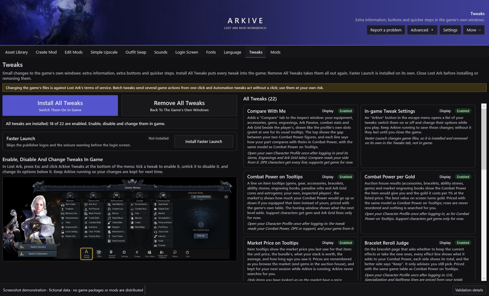
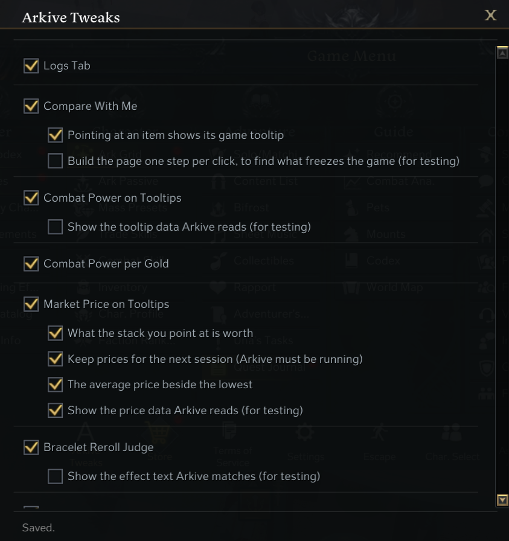
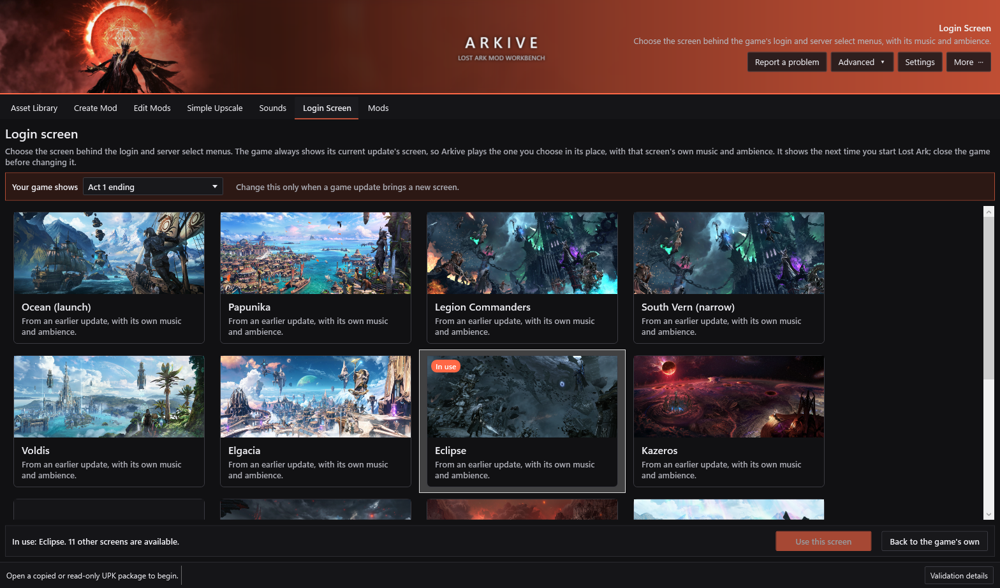

# Arkive

**A Windows mod workbench for the Western/global Steam version of Lost Ark.**

Arkive finds game assets, exports editable working files, validates changes, rebuilds protected Unreal Engine 3 packages, and applies or restores mods with hash-verified backups. Mods are shared as portable `.arkive` files. The project includes a WPF desktop application, a command-line interface and a reusable core library.

Arkive is an **AGPL-3.0-only public preview**; the current version is on the [Releases](https://github.com/AN-SOTP/Arkive/releases/latest) page. This repository contains current source, tests, build infrastructure, dependency notices, GUI screenshots and application artwork/icon. No game packages, exported game assets, databases, mods, personal settings, credentials or historical development checkouts are distributed.

**Using Arkive always carries inherent risk. Creating, sharing or using mods may result in account suspension or a permanent ban.** There is no guarantee against crashes, client repairs, incompatibility, data loss or account sanctions. Use a client you are authorized to access and keep independent backups.

Mods contain or are derived from Lost Ark game data owned by its rights holders (Smilegate and Amazon Games), which Arkive does not license to anyone. Selling access to that data is commercial use of someone else's property, and anyone who does so carries that risk alone. Paywalled mods are not welcome in this project's issues, discussions or releases, and I request that no modifications made via Arkive are paywalled in any way, and are made publically
available.

Arkive operates on files **while the game, launcher and anti-cheat are closed**. It does not inject code, attach to the game process, disable anti-cheat or provide runtime hot-swapping. Closing those processes and passing Arkive's validation do not eliminate the risks above.

## Screenshots

The actual desktop GUI. The library and mod screenshots use fictional demonstration data; the Asset Viewer, Zone Viewer and Recolour screenshots show game models and maps read from a locally installed client. None of them are installable mods, and the repository contains no game files or personal library data.

### Asset Library

Search technical filenames and in-game names, then inspect an asset or its relationships.


### Edit Mods

Keep a named draft, edit its working assets and add individual assets or a mesh's complete dependency kit.


### Mod Library

Enable mods, set priorities and review the effective asset selection before applying changes. Ctrl or Shift click several mods to turn them on or off, update or pack them together; right-click a mod to rename, update or delete it. After a game update, **Check after game update** says which mods are ready, and **Rebase mods** sets up the ones the update changed.


### Asset Viewer

Every LOD from Arkive's own decoder, coloured by the game's own compiled shaders, including glow and effect materials.


**Preview with edits** shows a mod's working files on top of the original asset and refreshes when they are saved (below shows a recoloured wing texture for Kazeros and changed hair colour for Serca).


### Zone Viewer

Search a zone's name to open its map. Every part is grouped (terrain, sky, fog, lighting and colour grading, effects, characters, meshes, materials, textures) and marked as this map's own or shared with other maps, so a recolour changes only what you mean it to.


### Recolour

Recolour every selected picture, material and effect of a mod at once with one colour choice and a live before-and-after preview. Two-tone repaints in a main colour and puts a highlight colour on the lightest details and glows (here: Archdemon Kazeros in white with gold).


### Skill preview

Player classes, bosses and other NPCs play their skills from the game's own skill data: the animation, the weapon in hand, and every effect at its time and socket, drawn with the game's own effect shaders.

| | |
|---|---|
|  |  |
| **Kazeros** | **Echidna** |
|  |  |
| **Thaemine** | **Serca** |

### Tweaks (WIP)

Small changes to the game's own windows: extra information, extra buttons and quicker steps. Install them from Arkive's **Tweaks** tab, then switch each one on or off and change its options in game from the **Arkive Tweaks** menu. Logs tab NOT publically available at the moment.





### Live in game example

Mods made with Arkive, running in Lost Ark.

**Kazeros 2-3 Cutscene**

https://github.com/user-attachments/assets/1f6c9379-cdef-4ee6-ab5f-9dbd0af5e39a

**Character creator**

https://github.com/user-attachments/assets/d1f532b4-41b6-44d6-9351-42392d6c7d74

**Echidna Raid Cutscenes**

https://github.com/user-attachments/assets/81b639c8-ce7a-41b1-869f-009deb6645c7

## Contents

- [Install and first run](#install-and-first-run)
- [GUI workflow](#gui-workflow)
- [Game names and metadata](#game-names-and-metadata)
- [CLI workflow](#cli-workflow)
- [How it works](#how-it-works)
- [Game updates and recovery](#game-updates-and-recovery)
- [Reporting a problem](#reporting-a-problem)
- [Application updates](#application-updates)
- [Build and release](#build-and-release)
- [Limitations and known issues](#limitations-and-known-issues)
- [Privacy, security and licensing](#privacy-security-and-licensing)

## Install and first run

### Requirements

- Windows 11 is recommended, 64-bit x64-compatible. The installer allows Windows 10 1809+, but .NET/OS support depends on edition and lifecycle; see [Microsoft's supported OS list](https://github.com/dotnet/core/blob/main/release-notes/10.0/supported-os.md). Older Windows and Windows on ARM are not verified Arkive targets.
- A Western/global Steam Lost Ark installation; write access to its Packages folder when applying/restoring mods.
- Space for exports, decoded packages, staged builds and original backups. A large kit can use several times its source package size.

### Installer

1. Download the latest `Arkive-Setup-X.Y.Z-win-x64.exe` from [Releases](https://github.com/AN-SOTP/Arkive/releases/latest). Optionally compare `Get-FileHash -Algorithm SHA256 PATH` with the release's `.sha256` file.
2. Close running Arkive instances, run the installer and choose destination/shortcut options.
3. In **Asset library → Library setup**, select your client's `EFGame\ReleasePC\Packages` directory and choose **Build / update index**. Source packages are read, never renamed.
4. Choose **Build game DB**, select `EFGame\data2.lpk`, and wait for the mapping to load. Technical and in-game-name searches are now available.

The per-user installer needs no administrator access and installs to `%LOCALAPPDATA%\Programs\Arkive`. It brings its own tested copies of everything it needs (the .NET runtime, UModel, Crunch, SDL and SQLite), installed privately beside Arkive, so no separate .NET, Visual Studio, Python or QuickBMS install is needed, even offline. Upgrades keep the separate data folder.

The preview installer is **not Authenticode-signed**. Windows may show an unknown-publisher/SmartScreen warning. Verify trusted source and hashes; hashes are not publisher signatures.

### Data and existing libraries

Installed Arkive keeps `mods`, `staging`, `cache`, `backups`, `logs` and downloaded `updates` under `%LOCALAPPDATA%\Arkive`. Application upgrades/uninstall preserve this folder. Uninstall does not restore the game: restore active mods first.

Each session writes a log to `logs` with the Arkive, Windows and .NET versions and every mod's state. Attach it when reporting a problem.

Source/portable builds retain project-root behavior. Set `ARKIVE_DATA_ROOT` to use an existing library or another drive. This does not automatically move another checkout's data:

```powershell
$env:ARKIVE_DATA_ROOT = 'E:\ArkiveData'
& "$env:LOCALAPPDATA\Programs\Arkive\Arkive.App.exe"
```

Use a trusted local folder, not the game's Packages directory. Avoid simultaneous instances against one data root. Back up the whole data folder for migration: shared `.arkive` files are portable, but drafts, source evidence and restore receipts are separate.

## GUI workflow

The main tabs are **Asset Library** (find assets), **Create Mod**, **Edit Mods**, **Simple Upscale** and **Outfit Swap** (make mods), **Sounds**, **Login Screen**, **Fonts**, **Language** and **Tweaks**, and **Mods** (apply and restore). **Advanced** keeps native diagnostics and specialist workflows.

### Asset Library

Search **All names and filenames** by package filename, object, class or in-game name; the index includes assets whose class is not moddable. Filter by asset type and class: a base body's class filter also finds the classes built on it, so Female Warrior shows Slayer and Valkyrie skins too. From a result you can inspect it in UModel, browse its package, export it, copy its identity or follow its relationships, each labelled as a database link, a verified dependency or a candidate. The index is resumable; refresh it when the client changes.

**Preview** (or double-click a mesh) opens the Arkive Asset Viewer:

- Every LOD of skeletal and static meshes from Arkive's own decoder, with LOD and UV switching, wireframe, normals, skeleton and sockets, UV layout, material IDs, vertex colours, texture channels and screenshots. PgUp/PgDn steps through the results.
- Materials run **the game's own compiled shaders**, so packed masks (such as two-tone hair), glow and effect materials look as they do in game. Colour recipes and UModel's stored textures stay available for comparison, and **Export colours** saves each material's colours as textures. The first preview indexes the game's shaders once (about 30 seconds).
- **Animation** plays the character's own animations (idles, emotes, dances, walking and running), so clipping shows in motion. **Lighting**, **Game environment** and **Sky** light the model with the game's own environment maps and skies, with a sun you can aim and recolour and a few presets.
- **Preview with edits** shows a mod's edited mesh, pictures and material values on the clean asset and refreshes when they are saved; **Your edits** (E) switches back to the original. The view also refreshes when a package it reads changes, for example after Apply.
- The viewer needs the Microsoft Edge WebView2 Runtime, which ships with Windows 10 and 11.

**Skills** (a tab of the Asset Viewer) plays a class's or an NPC's skills from the game's own action files: each stage's animation, the weapon in hand and every effect at its time, socket and size, drawn with the game's effect shaders. Open a boss model such as Kazeros's `MN_CNCS_00_SK` to list the skills of every NPC that uses it. Tripods and alternative effect sets are listed separately, and skills play at 0.1× to 1× speed. NPC skills have no names in the game's text, so they are listed by the developers' (Korean) names.

**Zone names** are searches too: type Final Day and a map card appears above the results, and results name the maps an asset is used in. Map cards and map results are left out when a class filter is set or the asset type is one maps do not hold. **Open in Zone Viewer** lists the map's parts by kind (terrain, sky, fog, lighting and colour grading, effects, characters, meshes, materials, textures), each marked **Only this map** or **Shared with N other maps**, with **Recolour and add to mod**, **Add selected to mod** and **Export selected…**. Its **3D Map (Early Preview)** tab draws the whole map with its baked lighting, fog and colour grading; it is very rough, and many areas will not look as they do in game.

### Create

1. In **Create Mod**, enter a name and optional version, author and description. **Create Mod** saves a draft and opens **Edit Mods**; no game files change.
2. Expand **Add assets**, search and select results. **Add asset only** prepares one editable GLB, PNG/DDS or material project. **Add mesh + textures/materials** prepares a skeletal mesh with every texture and material it uses. References start excluded; tick **Include** only for assets your mod should replace. Where a package holds two same-named textures or materials, the working list shows their group so they can be told apart.
3. **Preview original** opens meshes in the Asset Viewer and textures and materials in UModel. Extraction shows its progress and can be cancelled.
4. Select a working asset and use **Open edited file**, **Working folder**, **Replace file**, **Compare with original** or **Edit material**. When a working mesh is saved again (for example from Blender), Edit Mods checks it as soon as you come back to Arkive: a mesh that would be refused shows **Fails mesh check** and lists each problem with what to do.
5. **Save mod** validates the included edits and writes a `.arkive` file. New mods start disabled; saving is not installing.
6. **Preview changes** shows the result without changing files. **Save and apply** saves, enables, shows the plan and applies after you confirm.
7. **Share** saves and validates before copying the portable file where you choose.

### Edit

Choose **Mods → Edit mod**, or use the **Edit Mods** selector. Missing working copies are prepared against a verified clean client (from verified backups when a mod is installed), and existing working edits are kept. Edit, save, then preview or apply with the game closed.

**Recolour…** recolours every selected picture, material and effect at once (all of them when nothing is selected), with a live before-and-after preview. **Tint** keeps each colour's shading and takes the new hue; **Two-tone** repaints in a main colour and puts a highlight colour on the lightest details and glows. You can limit it to one colour range or the light areas, and **Lighten** lifts surfaces a material dims on purpose. Pictures start from the game's colours, so trying again replaces the last recolour, unless you changed them elsewhere. In the Asset Viewer's **Skills** panel, **Recolour this model and its effects…** adds a boss's or class's pictures, materials and skill effects to a mod and opens Recolour on them.

Ctrl-click toggles rows, Shift-click selects a range and Ctrl+A selects every row. **Remove selected** works on all selected assets. Pane sizes, density, theme and banner choices are remembered.

### Simple Upscale

**Simple Upscale** reshapes player bodies and outfits, and the NPCs Brelshaza, Echidna, Nineveh, Serca and Beatrice, without Blender. Search for an outfit piece and choose **Open in proportion editor** (tick **Open the whole outfit** for its other pieces too). Sliders cover the arms and neck, breasts or chest, waist and belly, hips and buttocks (including height), and legs; the model changes as you move them. **Save as mod** saves a new mod with each piece reshaped.

- Each area is found from the bones that move it, so tight clothing and the body under it change together and an outfit's pieces keep meeting at their seams. Every class of a base body shares its tuning.
- **Loose clothing follows the body** and **Hair follows the body** (on by default) move skirts, capes, sashes and hair with the body so it does not grow through them.
- Thickness, shape and placement change; height and limb length do not, because the skeleton and animations set them. Saving runs the usual skeleton and animation checks.
- **Presets** keep a body's sliders. **Apply preset to selected outfits** reshapes several outfits into one mod without opening the editor, and **Apply preset to every outfit of its body** does every outfit of that body (about 290 outfits for Female Warrior, around half an hour, about 9 MB per piece). Arkive says how long and how much space it needs first, can work on several pieces at once on PCs with four or more threads, and **Stop** keeps the pieces done so far.
- To change a saved upscale mod, right-click it in **Mods** and choose **Edit Simple Upscale** (or open it in **Edit Mods** and choose **Edit in proportion editor**). **Save as mod** then updates that mod; if it is on, choose **Apply changes** to put the new shape in the game. A body-wide mod (or one with more than 20 pieces) opens in one outfit as a preview, Nightwear when it has it; saving reshapes every outfit of its body again (or all of the mod's pieces), with progress and **Stop** in **Simple Upscale**.
- A mod changes the outfit for every character you see wearing it. Very large values can still make pieces overlap.

### Outfit Swap

**Outfit Swap** puts any player outfit in place of another, on any body: for example an Assassin's anniversary outfit worn as a Slayer's class skin. Search on the left for the outfit to wear and on the right for the one it replaces, by in-game or object name. The class box above each list shows one class's own skins and its body's outfits. Select one of each and choose **Preview swap…**; right-click an outfit to open it alone in the Asset Viewer.

- The outfit is moved onto the other body's skeleton and given that body's shape, learned from costumes the game makes for both bodies. The first swap between two bodies learns this (about a minute); later swaps reuse it.
- Cloth that would end up inside the new body is pushed back out. Bare skin takes the new body's shape, skin picture and layout so it matches the head and skin tone, and bare hands are the new body's own. Feet and shoes keep their shape, see-through cloth stays see-through, and panels hanging at the back follow the back rather than the arms.
- By default the outfit is painted into the replaced outfit's own pictures and materials with the game's shaders, so nothing is added to the game. Dyeing it in game has no effect, because its colours are in the pictures.
- **Keep the outfit's own materials (experimental)** draws it with its own game materials instead (sheen, see-through cloth and glow included). The mod also changes the item looks in `data4.lpk` that draw the replaced outfit, colour variants included, and the outfit's own package must stay in the game.
- **Body shape** reshapes the swapped outfit with your Simple Upscale mod or preset for that body. Where both mods change the same pieces, give the swap the higher priority.
- The preview shows the new body's face and hair and plays its animations. **Save as mod** saves the swap through the usual mesh, skeleton and animation checks.
- Outfit Swap is not 100% accurate, and there will be issues: see [Limitations and known issues](#limitations-and-known-issues).

### Particle effects and interface

**Particle effects** are a mod type: search for an effect, **Preview** it in its own window, or add it in **Edit Mods** and choose **Edit effect**. The window plays the effect live and shows each change as it is made: tint colour and strength, and multipliers for brightness, opacity, size, lifetime, spawn rate and speed, with emitters you can hide one by one.

**Interface movies** (the game's HUD and menu movies) are a mod type too, and interface names are searchable, so "health bar" finds the picture that draws it. In Edit Mods, **Edit colours** recolours a texture whole or one named part of an interface atlas at a time.

### Sounds

**Sounds** plays the game's sound effects, voices and music and replaces clips with your own audio. Search by a sound's name: the names are the developers' own (bgm for music, vox for voices, Korean boss names such as kazeroth for Kazeros; some bosses are translated for you).

**Listen and replace** (or a double-click) opens the sound's clips with playback controls. **Replace with audio file** takes a .wav, .mp3, .ogg, .flac, .m4a or .wma file and writes it into the game's audio files (close Lost Ark first). For music, **Fit sound bank to new length** (on by default) changes the song's timing in the sound bank so a longer or shorter file plays through and loops; without it, a longer file is cut with a fade and a shorter one ends in silence. **Restore original** and **Restore all sounds** put the game's audio back byte for byte. A game update or a Steam file check puts the originals back; the clip then says so.

### Login Screen

**Login Screen** brings back the screen of an earlier update (Eclipse, Kazeros, Kurzan, Vern, Voldis, Elgacia, Papunika and more) behind the login and server select menus, with its own music and ambience. Pick a tile and **Use this screen**: Arkive writes that video over the current screen's file and points the screen's music at the chosen one's. **Back to the game's own** puts everything back byte for byte. It shows the next time Lost Ark starts, and a game update replaces it. Faton's video is in a format Arkive cannot read yet.



### Language

**Language** shows the game's text in Spanish, French or German, which `data2.lpk` still holds even where the game removed them. Arkive writes the chosen language's lines over the English ones; untranslated lines stay in English, and French and German stopped getting new translations when they were removed. Each tile shows how much is translated. Arkive keeps a copy of every translation, so a language the game later drops can still be used. Voices are not changed. **Back to English** puts `data2.lpk` back byte for byte.

### Tweaks

**Tweaks** (Early Preview) changes the game's own interface code to add information, buttons and shortcuts. **Install All Tweaks** builds them into the game's interface files from clean copies and installs them like a mod; **Remove All Tweaks** puts those files back. **Faster Launch**, which skips the publisher logos and seizure warning, is installed on its own. Close Lost Ark before installing or removing.

In game, press Esc and choose **Arkive Tweaks** at the bottom of the menu: tick a tweak to turn it on, untick it to turn it off, and change its options there. Keep Arkive running while you play so those choices are kept for next time.

- **Information:** Combat Power on Tooltips (what an item would add to your Combat Power), Combat Power per Gold in the auction house and market, Market Price on Tooltips, Compare With Me (your gear beside an inspected player's), Bracelet Reroll Judge, Astrogem Processing Advisor, Lobby CP in the party finder, Slot Tweaks (item properties at a glance, including bracelet effects), Buff Icon Stacking, Additional Top Currencies and the Extended Escape Menu.
- **Quicker steps:** Fast Advanced Honing, Fast Paradise, Auto-Dismiss Stone Faceting Results, Next Item Button, Chest Opening Tweaks, Market Tweaks, Exchange Max Button and Universal Storage Claim.
- **Automation:** Auto Pull Up presses a hosted lobby's Pull up again while its box is ticked, and Ready Check Tweaks can accept the ready check (off by default).

Tweaks are newer and less tested than other mods: some read English text and only work on an English client, and a game update can stop one working until Arkive is updated. See [Limitations and known issues](#limitations-and-known-issues).

### Game tables

**Mods → Game tables…** makes a Game Data mod: changes to cells of the game's own tables in `data2.lpk`, such as which model an item shows, which NPCs show a name tag, or camera blur and zoom. Pick a table, find rows by any value and double-click a cell to change it. **Import .sql patch…** reads a LostArkPatcher-style patch of `UPDATE` statements and refuses anything else. Game Data mods follow priorities, Apply, **Restore all game files** and the game-update check like other mods, and share one write of `data2.lpk` with the Language tab. **More actions → Edit table changes…** adds table changes to any mod.

### Import, priorities and deployment

Use **Mods → Import**, drag `.arkive` files onto Arkive, or open one with Arkive. Arkive asks before importing, and new mods are turned on, but nothing reaches the game until you apply. Review, set priority, preview the plan, then confirm **Apply changes**.

- Higher priority wins for the **same asset**. Edits to different assets in one package are combined into one package. Equal-priority competing edits block Apply: change priority or use **Make this mod win**.
- **Search Mods** filters the list by name, author or pack.
- Ctrl- or Shift-click several mods to enable, disable, update or pack them together. Right-click a mod to rename it, change its author, update it or delete it.
- When enabled mods change the same assets, a warning above the list names each pair and which mod wins. **Hide** keeps it out of the way until the overlaps change; ties cannot be hidden.
- **New pack…** (or right-click → **Add to pack**) groups mods under one heading whose box turns them all on or off. Each mod keeps its own priority.
- Enable and priority changes take effect in the game only when you apply.

#### Restoring the original game files

There is no separate restore button for a mod: the **On** ticks say which mods should be in the game, and **Apply changes** makes the game match them.

- **Restore one or more mods:** untick **On** and choose **Apply changes**. A package no enabled mod changes any more is put back from its verified backup; a package another mod still changes is rebuilt without the unticked ones. Until you apply, a disabled mod shows **Disabled · still in game until Apply**.
- **Restore everything:** **Restore all game files** puts back every package Arkive installed and keeps your ticks, so a later **Apply changes** reinstalls them.
- **Delete mod** (a Mods button, or on right-click) deletes the chosen mods from the library. It refuses mods whose files are still in the game and names them: disable them, choose **Apply changes**, then delete.
- **Game file changed outside Arkive** in the Status column means a file your mods target was changed by something else: another Arkive data folder, another tool or a game patch. Apply is held back so the changed bytes are never built on. If an older Arkive installed mods, choose **More actions → Restore from another Arkive folder…** and pick its data folder (the one holding its `backups` folder); each original is checked by its SHA-256, the replaced file is kept under `backups\replaced-outside-arkive`, and Lost Ark must be closed. Otherwise use Steam's Verify integrity of game files, or after a game patch see [Game updates and recovery](#game-updates-and-recovery).

**Advanced → Package projects** keeps per-package rebuild, inspection, bulk install and restore, and cleanup. Prefer the named-mod workflow for normal use.

## Game names and metadata

No game database is distributed. Both the installed GUI and CLI build the in-game-name mapping directly from your client's `EFGame\data2.lpk`. In **Asset library → Library setup**, choose the language and **Build game DB**. Progress shows archive decoding and mapping stages; **Cancel DB build** stops the operation. The resulting mapping loads automatically and is remembered for the next launch.

```powershell
$cli = "$env:LOCALAPPDATA\Programs\Arkive\Arkive.Cli.exe"
& $cli database-build 'E:\Games\Lost Ark\EFGame\data2.lpk' --language English
# Optional explicit destination and JSON result; progress goes to stderr:
& $cli database-build 'E:\Games\Lost Ark\EFGame\data2.lpk' --out 'E:\ArkiveData\staging\lpk\arkive-asset-metadata.json' --language English --json
```

The default output is `staging\lpk\data2-fixed\arkive-asset-metadata.json` under Arkive's data root. **Load mapping** accepts an existing JSON. Rebuild after client updates when mappings change; then refresh verified asset links as needed. Database building does not itself scan every UPK or generate those dependency links.

The builder reads the supported tables read-only; decrypted tables are temporary and only the mapping is kept, and a failed or cancelled build leaves the previous mapping in place. Unsupported protection or schema changes are refused. All outputs stay local; do not redistribute game databases or generated mappings.

## CLI workflow

The installer includes `Arkive.Cli.exe`. For source builds replace `& $cli` with `dotnet run --project src/Arkive.Cli -c Release --`. `--help` lists all native commands; `--version` prints the version. Most commands accept `--json`. Paths/object names below are examples, not real required asset identities.

```powershell
$cli = "$env:LOCALAPPDATA\Programs\Arkive\Arkive.Cli.exe"
$data = "$env:LOCALAPPDATA\Arkive"
$packages = 'E:\Games\Lost Ark\EFGame\ReleasePC\Packages'
& $cli --help
& $cli inspect "$packages\PACKAGE.upk" --json
& $cli catalog "$packages\PACKAGE.upk" --filter hero
& $cli index-build $packages --cache "$data\cache\library-index" --workers 4
& $cli index-search $packages --cache "$data\cache\library-index" --metadata "$data\staging\lpk\arkive-asset-metadata.json" --query 'Brelshaza' --scope ObjectAndInGameName --limit 50
```

Use the exact physical package/object identity from your own index. Do not rename client packages. Initialize the data root/game configuration in the GUI before library deployment commands.

### Shared mods

```powershell
& $cli arkive-inspect 'E:\Downloads\Example.arkive' --json
& $cli arkive-import 'E:\Downloads\Example.arkive' --root $data
& $cli arkive-list $data
& $cli arkive-set $data --mod 'Example' --enable --priority 5
& $cli arkive-conflicts $data
& $cli arkive-plan $data --json
# Review first; game/launcher/anti-cheat must be closed:
& $cli arkive-apply $data --confirm

# Restore packages no longer contributed by this mod:
& $cli arkive-set $data --mod 'Example' --disable
& $cli arkive-plan $data
& $cli arkive-apply $data --confirm
```

Use IDs from `arkive-list` when names collide. Import supports `--enable`, `--priority N` and explicit `--replace`; game installation still needs Apply. `arkive-update` concerns **game-client compatibility**, not application updates:

```powershell
& $cli client-update-check-all $data --json
& $cli arkive-update $data --mod 'Example' --json
& $cli arkive-plan $data
```

Game Data mods can be made from a `.sql` patch, and `game-data-mod` without `--sql` lists the table changes in `data2.lpk` (or in one mod with `--mod`):

```powershell
& $cli game-data-mod $data --sql 'E:\Downloads\outfit-swap.sql' --name 'Outfit swap'
& $cli game-data-mod $data
```

### Lower-level authoring

The CLI exposes native project stages rather than the GUI's interactive named draft. Each stage reports a manifest consumed by the next; use actual reported paths.

```powershell
# Texture: export, edit PNG/DDS externally, register a project:
& $cli texture-export-native "$packages\PACKAGE.upk" --object OBJECT --alias ALIAS --out "$data\staging\manual\texture"
& $cli texture-project-create 'PATH\arkive-native-texture.json' --edited 'PATH\edit.png' --workspace "$data\staging\texture-mods" --name 'Example texture' --alpha preserve-original

# Simple upscale: reshape an editable player or supported NPC mesh GLB by area (percent), optionally moving loose cloth and hair too:
& $cli body-proportions 'PATH\editable.glb' --set chest=20 --set hips=10 --loose-clothing --hair --out 'PATH\edit.glb'
# Viewer animations: convert a character's AnimSet into the viewer's cached clips:
& $cli model-viewer-animations "$packages\PACKAGE.upk" --animset pc_wr_f_00_ani --cache 'PATH\animations'
# Skeletal mesh: recon, editable export, external GLB edit, validation/registration:
& $cli skeletal-mesh-recon "$packages\PACKAGE.upk" --object OBJECT --alias ALIAS --out "$data\staging\manual\mesh"
& $cli skeletal-mesh-export-editable 'PATH\arkive-skeletalmesh-recon.json' --out 'PATH\editable'
& $cli skeletal-mesh-preflight 'PATH\arkive-editable-skeletalmesh.json' --edited 'PATH\edit.glb' --json
& $cli skeletal-mesh-register-edit 'PATH\arkive-editable-skeletalmesh.json' --edited 'PATH\edit.glb' --workspace "$data\staging\skeletal-mesh-edits" --name 'Example mesh'
```

Static stages are `static-mesh-recon`, `static-mesh-export-editable`, `static-mesh-preflight`, `static-mesh-register-edit`, `static-mesh-compile`. Material stages begin with `material-recon` and `material-create-edit`; use `--help` for their exact options. Modify supported parameter manifests, not guessed raw offsets.

The advanced CLI exposes each texture reconstruction stage, skeletal topology compilation, staged-UPK construction, `package-compose`, bundle readiness and explicit `mod-install`/`mod-restore`. These use native evidence manifests, not a `.arkive` directly. `arkive-migrate $data` converts existing selected package-project assets to portable mods without changing installed game files. Then inspect/enable/plan/apply normally. New interactive cross-package authoring is simplest in the GUI; there is no single CLI equivalent to its named draft form.

Normal exit codes: `0` success, `1` failed/refused or a blocking audit finding, `2` invalid invocation. Read reports/diagnostics even when a command succeeds. Do not casually mix legacy deployment and named-mod deployment; reconcile their exact receipts and conflicts.

## How it works

### Packages and protection

The verified profile uses UE3-derived UPK `FileVersion 868`, `LicenseeVersion 16`, Lost Ark flags `0x44`, extended tables, AES-256-ECB-protected chunk prefixes and LZ4. Arkive reads a logical image, preserves unrelated serialized data, rewrites supported exports/offsets and reconstructs physical chunks/protection. No-op/decode-back and unrelated-export proofs bind outputs to clean source bytes.

The built-in Western/global protection profile is `western-global-steam-v1`. It does not imply support for other regions or future protection layouts. LPK/database archives use a separate protection profile.

### Textures and materials

Verified paths cover BC1/DXT1, BC3/DXT5, BC5/ATI2, supported Unity-Crunch and UE3 bulk mips. Native manifests retain format/dimension/mip contracts and alpha policy. An edited image keeps the original size, or is exactly 2× or 4× it on both sides (up to 4096×4096): Arkive then adds the larger mip levels above the original ones and updates the texture's size properties. Other sizes are refused. Arkive rebuilds required mip payloads and validates decoded results. Preserve normal-map semantics; colour changes do not permit arbitrary compression/layout changes.

#### Texture maps for artists

What each kind of game texture holds, so you know what to paint. A material instance names its textures by parameter (shown in the Asset Viewer's material panel), and file names usually end in a matching suffix. Rows marked *inferred* come from Arkive's colour recipes and have not been checked against the game's compiled shaders yet; treat them as a strong hint, not a rule.

| Parameter | Usual suffix | What it holds |
| --- | --- | --- |
| `texture_diffuse`, `texture_basecolor` | `_d` | Base colour (sRGB). Alpha is opacity on masked and translucent materials. |
| `texture_normal` | `_n` | Tangent-space normal map, DirectX style (green points down). |
| `texture_specular` | `_s` | Specular strength; brighter reads as shinier. *Inferred.* |
| `texture_orm` | `_orm` | Occlusion in red, roughness in green, metalness in blue. *Inferred.* |
| `texture_mask_variation` | `_cm`, `_m` | Colour-variation mask: red, green and blue each pick a region that the material's `diffusecolor_a`, `_b` and `_c` tint. *Inferred.* |
| `texture_emissive` | `_e` | Glow colour, added on top of lighting. *Inferred.* |

**Hair is different.** Two-tone hair materials (`npc_hair_fur_*`, `pc_hair_fur_*`) don't store colour in their diffuse texture. Red is the shading, blue is the two-tone mask and alpha is opacity; the colours come from the material's hair colour parameters. Paint those channels as greyscale masks and recolour the hair through the material instead. NPC hair is verified; player hair is inferred.

**Painting tips:**

- Keep the original size, or exactly 2× or 4× it on both sides (up to 4096×4096). Other sizes are refused.
- Keep alpha where the original has it: removing it makes masked parts solid.
- Keep normal maps DirectX style. When you open a mesh in Blender, Arkive gives it an OpenGL-style copy of the normal map (green flipped) so it shades correctly there; that copy is only for viewing. Flip green back before using a normal map baked in Blender as a game texture.
- Colour edits keep the original compression. A texture with a colour-variation mask can often be recoloured by editing the material's tint parameters instead of repainting it.

Supported `MaterialInstanceConstant` edits cover proven scalar/vector parameters, compatible texture references and supported parent/reference fields. Arkive is not a shader compiler or arbitrary material graph importer. An emissive recolour may also need a material-tint edit. Particle effects and animation events are separate.

### Meshes, skeletons, cloth and morphs

GLB exports retain supported position/normal/tangent/UV/colour buffers, material sections, joints/weights, reference skeleton and stable vertex identifiers. Topology-preserving edits retain native structure. Topology-capable replacements compile changed LOD0 within bone/section limits and duplicate it into source LOD slots; independently authored LODs are not supplied by this route. Zero-area triangles already present in the game mesh are kept; new ones are refused with their location in Blender coordinates. Some meshes use one material in several slots (pc_sp_av_236b_dress_sk uses its base-body material twice); Blender imports the repeats as `name.001`, `name.002`, and Arkive maps each of those names back to its own slot.

Skeleton comparison checks names, hierarchy/bind transforms. Retarget workspaces help map donors but do not guarantee live animation compatibility. Animation-aware preflight checks weights, bounds and stress poses, not every animation/attachment/physics interaction. Verified cloth/morph links are preserved/remapped; unsupported or incompatible cases are refused. This is not a universal cloth solver, new physics importer or unlimited morph authoring system.

Supported StaticMesh render buffers can be replaced while retaining original BodySetup/collision and non-editable data. Collision is not regenerated. Extensive geometry changes still need sensible target weights, supported UV/colour contracts, material correspondence and attachment expectations. Entirely new skeletons/classes are not automatically accepted.

### Asset Viewer and game shaders

The viewer is a three.js page hosted in WebView2; Arkive prepares each scene natively. Geometry comes from Arkive's skeletal and static mesh decoders (UModel's glTF only when the native layout is unproven); materials, textures and properties come from UModel's export and dump of the same object, and every package they were read from is recorded so a later change rebuilds the scene.

Skills come from the client's data archives: `data3.lpk` holds each class's and monster's action file (every stage's animation and the events it fires: effects with their socket, offset, rotation, scale, effect set and parameters), `data4.lpk` the look files that name a character's mesh, AnimSets, weapons and parts and the sockets they go in, and `data2.lpk`'s skill and NPC tables name skills and say which action file and model each NPC uses. Particle systems are read from their packages, including modules they share with effects in other packages. The simulation follows Unreal Engine 3's particle modules; values a skill passes to an effect reach only the settings that read a parameter of that name, as in the game. Effects draw in their own high-dynamic-range pass over the scene, test against its depth and fade into the ground through the shaders' own soft-particle code, then are tone-mapped and bloomed in linear light.

Lost Ark's shader caches (the `ShaderCache` exports in `ReleasePC`) hold LZ4-compressed DXBC shaders and, for every compiled material permutation, its static parameter set, uniform expressions and base-pass pixel shader. Arkive indexes them once, matches each material instance (or its nearest parent with a static permutation) to the permutation compiled for exactly its switch and mask values, evaluates the uniform expressions with the instance's parameters into the registers the shader record names, and translates the disassembled shader to GLSL with D3D bit-exact register semantics. Engine inputs the viewer does not have (sky and ambient light, fog, exact world vectors) are neutral or approximated, so lighting is the viewer's own; the material's colour, masks and glow are the game's.

### Sounds

The game's audio is Wwise (2019.1, bank version 134) in `ReleasePC\WwiseAudioPackage`: `.pck` packages holding the sound banks and most clips, and loose `.wem` files holding most music, with per-language packages for voices. Every file there is scrambled with a 4-byte marker and a repeating key, and loose files are named by a scramble of their Wwise source id; Arkive reads both. A sound's name (the `AkEvent` objects in the game's packages) hashes to the Wwise event id; the event's play actions lead through the bank's object tree to its clips, and each clip's length comes from its own header.

A replacement is written as uncompressed PCM, which Wwise always decodes. Fitting music to a new length also rewrites the bank's music segments that play the clip (their length, exit cue and the clip's timing), recorded and restored the same way. A clip in a package is replaced by appending the new audio to the end of the package and pointing its one table entry at it, and every bank entry that describes the clip gets the PCM codec and the new size; nothing else moves. A loose music file is replaced whole, with a copy of the original kept under `backups\sounds`. `sounds\replacements.json` records every original value before anything is written, so restoring writes them back (only where the game still holds Arkive's values) and, once no replacement uses a package, cuts it back to its original length; the result is byte-identical to the original. Previews are decoded by vgmstream (`tools\external\vgmstream`) and kept in `cache\sounds\preview`.

### .arkive files, composition and deployment

An `.arkive` is a versioned ZIP-based container with manifest, edited payloads and target/source contract metadata, not a prebuilt game UPK. Local priority/enable state, absolute working paths, install receipts and backups stay in the user's library. Import validates paths, duplicates, counts/sizes, schema, kind/class correspondence, required entries and SHA-256. Unknown/newer schemas, unsafe paths, tampering and extra payloads are refused. New archive writes are re-read/verified before replacing their destination. A target whose name is shared by another object of the same class in its package also records its path inside the package (`tex.name`); every other target is written exactly as before. Arkive 0.2.3 and earlier install a mod with one such asset correctly while the game's object is unchanged, and refuse a mod that edits two same-named objects.

Enabled winners targeting one UPK are composed from a verified clean package, validated and backed up before controlled replacement. Receipts bind exact paths/hashes; unknown current bytes, altered approval evidence and unresolved identity block unsafe operations. A tied mod is never silently chosen. Portable mods contain data, not install scripts, but malformed inputs can still target parser bugs; only import files you trust.

## Game updates and recovery

1. **Before updating/reinstalling Lost Ark**, choose **Restore all game files** in the Mods tab while backups and receipts match. Your enabled mods stay ticked.
2. Update the client, close its processes and choose **Check after game update** in the Mods tab. When Arkive starts after Steam has updated Lost Ark it offers this check itself, and names any fonts, language or login screen the update put back. The check changes no game file: it shows in the Apply Plan which mods are ready, and checks that Arkive can still read and change the updated game files.
3. If the check finds mods whose assets the update changed, **Rebase mods** appears next to it. Rebasing sets those mods up against the updated game files, keeping each change only if it passes every native check, and moves working files the check proved unchanged onto the new files. Changed skeleton/layout/material contracts that fail need reauthoring. **Advanced → Game update safety** keeps the per-package evidence.
4. Refresh index/metadata as needed, then choose **Apply changes**. A newer Arkive is offered when Arkive starts, before anything loads; install it first if the game update needs it.

Steam reinstall changes game bytes but does not clear Arkive's library. If a mod remains marked installed/outdated, inspect current hashes and receipts; do not delete recovery evidence to silence a warning. Unknown bytes require verified restore or client repair. Keep backups until clean state is confirmed. Steam repair restores stock files, not edit contracts.

**Mods → Restore all game files** restores every verified active deployment (see [Restoring the original game files](#restoring-the-original-game-files)); **Restore all active** in advanced Package projects does the same for package projects. Deleting a library archive is not restoring the game.

## Reporting a problem

If something goes wrong unexpectedly, Arkive shows what happened instead of closing, and offers to create a problem report. **Report a problem** (top bar, or **Open session logs**' menu in Asset library) packs what's needed to find a problem into one zip: a summary (Arkive and Windows versions, data and game folders, whether the game is running, the last messages shown), the three most recent session logs, the mod list with each mod's state, and the checks of the meshes in the mod being edited. It copies the zip so it can be pasted straight into Discord, an email or a GitHub issue, and shows it in Explorer (it is kept in the data folder's `reports`). It holds file paths on your PC but no game files and no settings.

## Application updates

When enabled in Settings, Arkive checks GitHub's latest stable release when it starts and, before anything loads, asks whether to install a newer version. Installing saves your draft and settings, verifies the installer's exact size and SHA-256, runs it and reopens Arkive on the same data folder; mods and backups are never touched. If a check, download or install fails, Arkive says what failed and what to do, and the current version stays in place. Source and portable builds are not overwritten.

Releases are checked **without a GitHub token**; **Settings → Forget token** removes one saved by an earlier version. A token (fine-grained, **Contents: read-only**, kept in Windows Credential Manager) is only needed to update from a private fork. Untrusted hosts, wrong hashes, oversized files and downgrades are refused, but a compromised repository could still publish a malicious installer, so release review and code signing remain recommended.

## Build and release

### Developer requirements

Git, PowerShell, .NET **10 SDK**, Visual Studio/Build Tools with **Desktop development with C++**, x64 MSVC/Windows SDK, and [Inno Setup 6.7+ or 7](https://jrsoftware.org/isdl.php) for installer builds. Native toolset defaults to `v145`; VS2022 can use `v143`. NuGet restores pinned BouncyCastle.Cryptography, Microsoft.Data.Sqlite/SQLitePCLRaw and self-contained Microsoft runtime packs. Their notices are included in installer builds.

```powershell
git clone https://github.com/AN-SOTP/Arkive.git
cd Arkive
winget install --id Microsoft.DotNet.SDK.10 -e
# Install the C++ workload through Visual Studio Installer / Build Tools.
winget install --id JRSoftware.InnoSetup.7 -e -s winget -i

# Download Arkive-Tools-win-x64.zip from the v0.1.0 release:
.\eng\Get-ExternalTools.ps1 -Archive 'E:\Downloads\Arkive-Tools-win-x64.zip'
.\tools\Build-CrunchNative.ps1
# VS2022: .\tools\Build-CrunchNative.ps1 -PlatformToolset v143
.\eng\Verify-Arkive.ps1 -RequireExternalCrunch
dotnet run --project src/Arkive.App -c Release
```

`eng/ExternalTools.json` pins tested UModel/Crunch/SDL SHA-256 values and upstream sources. Do not replace them with random latest builds. The native decoder bridge is built from vendored source, not committed as a DLL.

```powershell
.\eng\Build-Installer.ps1
# The version comes from Directory.Build.props; -Version X.Y.Z only confirms it and refuses a mismatch.
# Optional: -IsccPath 'C:\Tools\Inno\ISCC.exe'
```

This verifies dependencies, runs both test suites, publishes self-contained win-x64 GUI/CLI/updater and compiles into `dist\releases`. `-SkipVerification` is for local iteration, not release acceptance. `eng/Publish-Arkive.ps1` remains a framework-dependent developer publisher, not the full installer pipeline.

On a clean Windows test account with no Arkive installed, `eng/Test-Installer.ps1 -Installer PATH` exercises installation, CLI/tool discovery, GUI launch, the staged updater/restart and uninstall against an isolated workspace. It refuses to overwrite an existing installation and retains test logs. It creates/removes the per-user test installation registration; do not run it while doing other Arkive work.

The verification baseline contains about **200 domain smoke cases** and an isolated WPF UI suite: archive/asset pipelines, import validation, composition/priority, restore/source contracts, discovery, selection/layout/theme and update validation. Set `ARKIVE_TEST_PACKAGE_DIR` for optional real-client tests. Synthetic tests cannot certify all live assets. Builds use nullable checks, warnings-as-errors, deterministic settings, neutral source path mapping and no managed Release PDBs; these do not prevent decompilation.

### Maintainers

`Directory.Build.props` is the only place the release version is set; the installer build, the release workflow and the application's update check all read it. To release, update `<Version>` there, review/test, then push `main` and a matching tag:

```powershell
git tag vX.Y.Z
git push origin main
git push origin vX.Y.Z
```

The tag-triggered Windows workflow refuses a tag that disagrees with `Directory.Build.props`, retrieves the pinned tool pack from `v0.1.0`, runs both test suites, builds the installer and its `.sha256` file and creates a **draft** release. Replace the draft notes, review the assets, then publish: publishing offers the update to every installed copy, while drafts/prereleases are ignored by the updater. The `v0.1.0` baseline was seeded manually; its tool pack is the bootstrap dependency for later release tags.

Run release jobs on reviewed repository-owned tags, not untrusted PR code with write credentials. Published installers and source are available from the Releases page.

`eng/Export-Source.ps1 -Destination NEW_FOLDER` creates an allowlisted fresh snapshot without history, generated binaries, user data or extra Markdown documents. It is an initial-publication aid, not the normal push process. Audit new dependency/artwork additions.

## Limitations and known issues

- Support is limited to verified Western/global Steam layouts; client updates can alter protection/serialization/contracts.
- Arbitrary new exports/imports/classes, renamed native asset identities, unlimited new skeletons and generic UE3/UE4/UE5 import are not implemented.
- UModel is an original-asset viewer/semantic oracle, not the game's renderer. Some shaders, streamed textures or animations differ; fork upgrades need a new verified tool baseline.
- The Arkive Asset Viewer runs the game's material shaders but not its renderer: lighting comes from the game's environment maps and skies with a single sun rather than each area's own lights, and there is no fog or physics (hair and cloth stay where the animation puts them); glow on models is scaled into a displayable range, and panning or flickering materials show a single moment. Materials without a matching compiled shader fall back to colour recipes or stored textures. It needs the WebView2 Runtime.
- The skill preview is an approximation of the game, not the game: effects are simulated by Arkive from the effect data (some rarer modules, ribbons and vortex forces are not simulated, screen distortion and effect lights are left out), there is no root motion, camera effects or hit reactions, and a skill's conditional branches are shown as separate versions. Large effects are best judged from a game-like high camera. Boss parts a skill summons separately (Echidna's mirror) are not shown, and NPC skills are listed by developer names.
- **Outfit Swap is not 100% accurate, and there will be issues.** Some materials and parts can come out wrong, particularly when putting Mage outfits on other bodies (hands, fingers and wrists especially). A Summoner outfit can show silver toes in the open world, dresses can come out slightly less bright than the original, and swaps onto male bodies and the Specialist are rougher. Check a swap in game before sharing it.
- Cross-character replacements may deform during live animations. Stress poses cannot prove every animation, cloth/morph/attachment or physics case.
- Some cloth/morph/animation layouts and references remain unsupported. Full kits can retain unresolved dependencies and first-time preparation can be expensive; progress is not a completion-time guarantee. When a package also holds a second mesh with the same name, UModel cannot tell them apart: its cross-check is skipped for that mesh, and the kit cannot say which same-named material the mesh uses, so it leaves that material in the exported kit.
- StaticMesh collision is preserved, not rebuilt. Large visible geometry changes can disagree with it.
- Shader compilation, particle edits beyond colours and value multipliers, interface movie edits beyond their textures, animation events and runtime injection/hot-reload are outside the verified workflow. Particle and interface edits are newer than mesh and texture edits and less tested in game.
- Old projects can lack current oracle/approval evidence, or retain stale installed state after reinstall. Rebuild/reconcile against verified clean bytes; unknown identity can intentionally block deletion/restore.
- Priority resolves target ownership, not semantic compatibility of all dependencies.
- The Zone Viewer's 3D map is a very early, extremely rough preview: Lost Ark's layered materials are only roughly reproduced, so many areas look different from the game, the arenas and camera angle are guesses, and some detail drops out when zoomed in. Pieces whose material lives in a package the map does not reference are drawn plain grey. Map lights and height fog colours are level settings Arkive cannot change yet.
- Recolour changes colours the game exposes (pixels, material colour settings, effect colour tables). Colour that comes from shared textures or base materials changes everything that uses them, and material edits are newer and less tested in game than texture edits.
- **Tweaks are an Early Preview.** They change the game's own interface code, so a tweak that misreads a window can make it misbehave, and the game can freeze or close. Some match English text and only work on an English client. Batch and Automation tweaks act for you, which the game's terms may treat more strictly. Remove All Tweaks before a game update, and after one, check Arkive for an update before installing them again.
- Login Screen edits game files outside the packages: one video in `EFGame\Movies` and two small sound banks in `WwiseAudioPackage`. Pictures need the game's own `bink2w64.dll` in `Binaries\Win64`.
- Game Data mods change the game's own tables, which are not looks-only: a change the game's server disagrees with may show wrongly or be ignored, and no change has been confirmed in game yet. They rewrite `data2.lpk` too and keep a compressed copy of each table they change. Only changes to existing rows are supported.
- Language rewrites `EFGame\data2.lpk` (about 1.4 GB) and keeps a compressed copy of the game's text (about 130 MB) plus the saved translations (about 85 MB) in Arkive's data folder. Grammar markers in translations (such as Spanish gender forms) are shown by the game's English text engine and are not yet confirmed in game.
- CLI authoring requires explicit manifest chaining; the GUI is the recommended named-mod editor.
- The installer/updater is an unsigned preview; uninstall preserves data and does not restore the game.
- Not every bug is known. Report it on [GitHub Issues](https://github.com/AN-SOTP/Arkive/issues) with version, operation, asset identity, failure code and a sanitized diagnostic excerpt. Review paths/names before sharing logs; never submit credentials or whole game packages casually.

## Privacy, security and licensing

No telemetry or credential upload is implemented. Asset operations run locally. Optional update checks contact GitHub with normal request metadata such as IP/user-agent. Local settings/logs contain local paths and asset identities; sanitize them before sharing.

Publication starts from a clean snapshot instead of prior commits. Mods, database/asset exports, caches, backups, builds, personal settings and AI configs are excluded. Application banners/icon and the interoperability key are intentionally retained. `THIRD-PARTY-NOTICES.txt` contains dependency licenses and artwork credits.

Bounded parsing, safe paths, exact source/backup hashes and explicit deployment confirmation are safeguards, not a formal security audit. Managed code remains decompilable; no secret client-side key can be made unrecoverable. A trusted installer still executes code. Game terms, anti-cheat policies and redistribution rights are separate from Arkive's licence; no bypass or stealth guarantee is offered.

Arkive's original code, tests, build scripts and documentation are licensed **AGPL-3.0-only**. See `LICENSE.txt` for the complete unmodified GNU licence and `COPYRIGHT.txt` for its scope. Distributed derivatives must provide corresponding source under the licence; modified versions offered for remote network interaction must offer source to their users. Recipients can redistribute it. Private modifications do not automatically require publication, and copyright licensing does not control independent implementations merely inspired by Arkive's ideas. See the [GNU licence FAQ](https://www.gnu.org/licenses/gpl-faq.html#GPLRequireSourcePostedPublic) and [AGPL section 13](https://www.gnu.org/licenses/agpl-3.0.html#section13).

Anyone receiving an installer must also have access to its exact corresponding source and build instructions. Third-party components retain their licences; Lost Ark artwork/trademarks and user/game assets are not relicensed as Arkive code. This project is not affiliated with Smilegate, Amazon Games or UE Viewer.

Primary references: [Lost Ark UModel fork](https://www.gildor.org/smf/index.php?topic=3055.0), [UE Viewer source/license](https://github.com/gildor2/UEViewer), [pinned Crunch source](https://github.com/Unity-Technologies/crunch/tree/8708900eca8ec609d279270e72936258f81ddfb7), [GitHub release API](https://docs.github.com/en/rest/releases/releases), [Inno Setup](https://jrsoftware.org/isdl.php).
